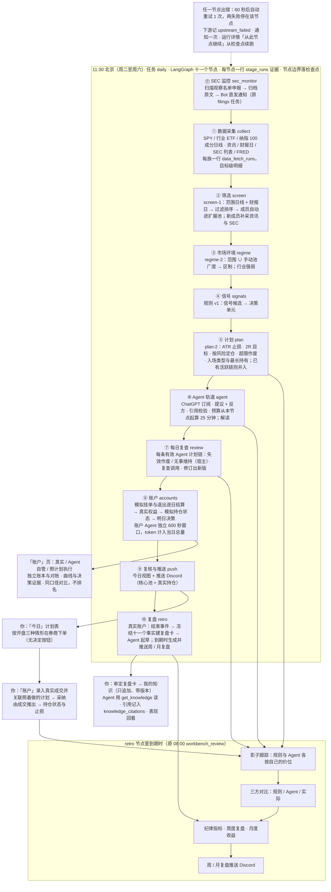

# 系统架构

> 版本 v2.11.0（2026-10-31，本地实现与发布准备）。只做美股；真实交易由人决定并下单，模拟账户由程序结算，不连接券商。
> 本文写到模块级。每个功能怎么用、怎么验证见 `features/`；怎么运行和维护见 `operations/`。
> 迁移 030 的真实库执行、服务重启与真实数据验收尚待单独授权。
> v2.12–v2.15 合并实施：代码已在主干，发布为 `v2.15.0`（日期 TBD），迁移 031 的真实库执行、重启与使用验收尚待单独授权。模块表已含五层新增模块；十一节点图保留为 daily-2 / stages-5 的旧版本，十三节点图见 §3。

---

## 1. 运行形态：一个进程 + 一个数据库

```
macOS LaunchAgent（local.investment-assistant，登录时启动，KeepAlive）
  └─ start.command → scripts/start_local.py → uvicorn 127.0.0.1:8787（单进程）
       ├─ FastAPI：/api/*（OpenAPI 在 /docs）
       ├─ 静态前端：web/dist（Svelte 5，单页应用）
       └─ 调度线程：每 60 秒轮询 scheduled_jobs，到点运行已注册任务
PostgreSQL：唯一的状态存储（调度、运行报告、行情、计划、成交、复盘）
```

外部依赖与缺失时的行为：

| 依赖 | 用途 | 缺失或失败时 |
| --- | --- | --- |
| yfinance | 日线、资讯标题、下次财报日 | 单个目标失败（连接 10 秒、总 30 秒，重试 2 次）只记入该目标的拉取明细与运行报告 `summary.sources`，不写库、不冒充「无信号」 |
| SEC EDGAR（`SEC_USER_AGENT`） | 8-K/10-Q/10-K 列表与下载、SEC 监控 | 列表失败记入运行报告；缺 `SEC_USER_AGENT` 时下载返回空 |
| FRED（`FRED_API_KEY`） | HY 信用利差、2s10s | 未配置记「未配置」，不发请求 |
| ChatGPT 订阅（Sign in with ChatGPT，在「设置 → Agent 连接」登录一次） | Agent 轨道、每日复查与模拟账户组合决策 | 未连接或连接失效时跳过需模型的建议、复查和组合决策，记录原因；规则计划、已有模拟挂单结算与自动退出照常 |
| Discord | 每日计划推送、周/月复盘推送、SEC 监控通知、工作流失败与连接失效通知 | 推送失败写入运行报告，下次推送附「上次推送失败」；推送只在没发出去和被限流时重试，不重发 |
| PostgreSQL（`INVESTMENT_ASSISTANT_DATABASE_URL`） | 全部状态 | 大多数接口返回 `degraded` 或 503，调度线程不启动 |

---

## 2. 代码分层

```
core ← data ← derivation ← execution ← analysis ← review ← optimize
                                    ↑ workflow / views ↑
                               api / services / tasks / notify
```

箭头表示依赖：每层只能依赖自身或左边的层，`workflow` 与 `views` 位于业务层之上，API、服务、任务、通知位于最外层。`db.py`、`config.py`、`runtime_paths.py`、`migrate.py` 是底层设施。守护测试检查全部 import（含函数内）与顶层模块环。SQL 按层归属，事务由调用方管理，公共事务入口唯一定义在 `core/tx.py`。

五层代码布局、迁移 031 仓储、纯函数注册表 / 校验器与编排接线已在主干：新运行为 `stages-6`、`daily-3`、`agent-4`、`agent-portfolio-2`，十三节点；031 未执行的库仍按旧版本读取（`stages-5` / `daily-2` / `agent-portfolio-1`）。工作台规则、计划、影子引擎、纪律、月度收益、三方对比、账户账本和订单校验仍是纯函数。下列路径相对于 `investment_assistant/`；各包 `__init__.py` 仅作包标识，Agent 包另保留公共版本与原因文案。

### core：共享底座

| 模块 | 做什么 |
| --- | --- |
| `core/tx.py` | `Unavailable`、`Gone`、`Deps`、连接与读写 / 只读事务、JSON 转换的唯一定义点 |
| `core/schema.py` | 缺表检查与各迁移就绪探测；031 检查十二张表与允许 portfolio 的阶段 CHECK |
| `core/features.py` | 四个功能开关的只追加历史、请求幂等与当前 / 冻结快照；无变更行默认开启 |
| `core/dbutil.py` | SQL 行读取、JSON 编码、锁与账户作用域公共函数 |
| `core/constants.py` | 预算、时区、基准、回溯窗口与固定账户 ID |
| `core/versions.py` | 全部计算口径版本的唯一定义点 |
| `core/texts.py` | 规则、动作、状态、原因等中文表；与前端逐字对齐 |
| `core/idempotency.py` | 请求哈希与幂等冲突 |
| `core/redact.py` | 密钥脱敏与失败原因清洗 |
| `core/http.py` | 共用 fetch-1 HTTP 超时、重试与错误分类 |
| `core/stages.py` | 阶段注册表、历史版本、分类与纯 `StageAcc` |
| `core/locks.py` | daily 会话锁、运行中探测与活动 run_id |
| `core/runner.py` | API 提交任务的进程内后台执行与状态 |
| `core/knowledge.py` | 112 张概念卡、原理页、引用解析与可见性；纯文件校验 / 渲染；CLI check / show |
| `core/llm/chatgpt.py` | siwc-1 OAuth、回环回调、PKCE、Responses 改写与安全错误码 |
| `core/llm/connection.py` | 唯一读写 Agent 连接与连接事件的模块；登录、刷新、状态与失效通知依据 |
| `core/llm/model.py` | 模型设置、客户端、错误分类、检查点与运行记录公共结构 |

### data：事实与采集

| 模块 | 做什么 |
| --- | --- |
| `data/calendar.py` | 交易日与收盘时点 |
| `data/identity.py` | 美股身份与代码校验 |
| `data/fetch_policy.py` | fetch-1 数据端口及 yfinance 两层截止时间 |
| `data/http.py` | 数据 HTTP JSON 读取 |
| `data/registry.py` | 九族有序注册与唯一主备调度；Stooq 未启用、Nasdaq 为财报日备源；`python -m investment_assistant.data.registry list / fetch <family> [--ticker T]`（逐只族必须给 `--ticker`：整族目标集合在工作流层解析，整族请用数据菜单或日批；写一行 `manual_family` 拉取记录） |
| `data/adapter_types.py` | Source / Adapter / AdapterDeps / TargetFacts 的唯一定义；宿主显式注入事实、事务和配置 |
| `data/adapter_support.py` | 唯一目标集合算法、滞后、存储回执与 SEC 真实尝试次数 |
| `data/families.py` | 读取 Adapter 的目录与覆盖投影；ATR 不再是数据族 |
| `data/tally.py`、`data/fetch_status.py` | 唯一目标计账、状态分类；全目标末次成功来源汇总后才截断明细 |
| `data/market_constants.py` | 原行业 ETF、宏观序列与窗口常量；指标不再为读常量引入采集栈 |
| `data/collect.py` | 共享 Tally 导出、fetch-run 写入与族锁；所有采集都是 `registry.run_adapter` 调用，逐族函数（`bars_one` / `news_one` / `sec_listing` / `fred_series`）与 `collect_range` 已无调用方而删除（R23） |
| `data/fundamentals.py` | SEC 财务身份、规范化与保留申报版本 |
| `data/research_rows.py` | 原始字节归档与财务观察包装的唯一实现 |
| `data/acquisition.py` | 行情旧记录归一化；共用下沉后的字节归档（本地 SEC 研究刷新已由 `sec_text` 适配器取代，R28） |
| `data/repo.py` | 日线、新闻、申报、财报日、宏观、采集记录与只读事实 SQL；补查队列一次结算 / 补重跑指针、行业截止读取、缺失交易日查询 |
| `data/adapters/bars.py` | yfinance 日线采集与存储形状 |
| `data/adapters/news.py` | 新闻标题与 SEC 8-K 列表 |
| `data/adapters/earnings.py` | 下次财报日 |
| `data/adapters/fred.py` | 信用利差与收益率曲线 |
| `data/adapters/universe.py` | 纳指范围文件与滞后检查 |
| `data/adapters/sec_listing.py` | SEC 目录与接受时间填充，保留原披露截止 |
| `data/adapters/fundamentals.py` | companyfacts 原归一化与财务观察版本存储 |
| `data/adapters/sector.py` | SIC 配置覆盖优先、两位分组；仅答案变化追加 |
| `data/adapters/sec_text.py` | 冻结截止前的最新 K/Q 与财报 8-K 主文 / EX-99.1；配置目录下每只每 session 最多三次原文下载（附件共用预算），超时次 session 再试 |
| `data/sec/local_evidence.py` | 共享本地原文归属、SEC 链接与监控元数据读取；适配器保留已验证附件，恢复安全索引路径，观察新增数独立于下载数 |
| `data/sources/stooq.py`、`data/sources/nasdaq.py` | 离线验证的 CSV / 财报日解析；Stooq 仅保留机制，不登记为可用备源 |
| `data/sources/edgar.py` | SEC 源、观察名单、SIC 与受理时间截止；旧监控 TSLA 年报默认不变 |
| `data/sources/fundamentals.py` | 基本面公共来源、原始字节与安全传输错误 |
| `data/sec/storage.py` | 配置驱动的 SEC 批量下载编排与文件索引持久化 |
| `data/sec/extraction.py` | 原文财务与指引提取；缺失值不推测 |
| `data/sec/report.py` | 原文来源报告 |
| `data/sec/monitor.py` | 扫描、归档、状态与历史去重；投递由 tasks 注入 |

### derivation：纯指标与推导

| 模块 | 做什么 |
| --- | --- |
| `derivation/chain.py` | derivation-1 独立重算、冻结触发条件与一致性核对；import 不带入 psycopg / tx / views |
| `derivation/indicators/registry.py` | 22 项 indicator-1 指标、窗口与截止；close / adj_close 均线、SPY / QQQ 基准分别登记 |
| `derivation/indicators/__main__.py` | `python -m investment_assistant.derivation.indicators list / compute <id> <ticker>`：只读，按最近已收盘交易日现算；`breadth` 需要宿主冻结的样本，命令行拒绝（`indicator_requires_universe`），`sector_strength` 只限行业 ETF |
| `derivation/indicators/_price_math.py` | 原价格数值公式唯一实现，精度与运算顺序不变 |
| `derivation/indicators/price.py` | 保留原价格接口，indicators 经注册表输出原键序与数值 |
| `derivation/indicators/breadth.py` | 广度、行业强弱与宏观数值 |
| `derivation/indicators/screen_metrics.py` | screen-1 收益率、均线与成交额 |
| `derivation/indicators/fiscal.py` | 实际财季、累计值差分、TTM、FCF 与精确口径计算 |

### execution：计划与账本

| 模块 | 做什么 |
| --- | --- |
| `execution/plan_levels.py` | 计划价位、有效期、财报标记、按风险定股数与 build_*_plan |
| `execution/plan_context.py` | 持仓与风险暴露、计划证据、规则计划生成 |
| `execution/entry_rules.py` | entry-1 入场类型、开盘情形与作废判定 |
| `execution/exits.py` | 持仓计划与当前止损 |
| `execution/positions.py` | FIFO 持仓与拆股 |
| `execution/conditions.py` | condition-2 条件校验与 met / not_met / unknown |
| `execution/plan_check.py` | Agent 计划、复查与修订的宿主校验、差异 |
| `execution/citations.py` | 提议与反方引用校验 |
| `execution/portfolio.py`、`execution/portfolio_types.py` | portfolio-check-1 纯硬检查与唯一结果类型；共享 max_shares、行业敞口与贪心现金顺序；只对入场链头给裁决 |
| `execution/portfolio_check.py` | 八段组合事实、订单与 holds 校验；缺段明确 missing，新增 portfolio_check |
| `execution/adoption.py` | execution-1：从成交推出采纳与执行状态 |
| `execution/timeline.py` | 链状态、版本有效期、系统信号、宿主结论与持仓状态纯计算 |
| `execution/chains.py` | 链事实、复查对象、持仓状态读取与写入；不调模型 |
| `execution/simulation.py` | PositionState、step_position、simulate / simulate_v2；影子与模拟账户共用 |
| `execution/ledger.py` | 成交与计划备注的只追加、幂等写入 |
| `execution/account_records.py` | 快照与现金流记录 |
| `execution/accounts.py` | account-1 现金、权益、Dietz 收益、回撤与对账纯计算 |
| `execution/trades.py` | 成交、备注、快照、出入金事务用例；旧决定入口 410 |
| `execution/user_inputs.py` | 用户材料的幂等追加、更正、撤回与截止读取 |
| `execution/paper/accounts.py` | 开账、参数、结算、权益、订单与机械决策；recent_closed 由上层必需注入 |
| `execution/paper/fill.py` | paper-fill-1 逐交易日模拟成交与退出 |
| `execution/paper/strategies.py` | follow-plans-1 机械挂换撤单、仓位约束与订单逐条校验 |
| `execution/repo.py` | 计划、成交、链、账户、订单、权益与决策 SQL；每账户 / 交易日首份组合检查固定、评论只补一次 |
| `execution/repo_legacy.py` | 旧 signal_decisions 只读查询；私有旧夹具写入由 tests 静态守护 |

### analysis：规则与模型用例

| 模块 | 做什么 |
| --- | --- |
| `analysis/rules.py` | v1 规则候选纯计算 |
| `analysis/synthesis.py` | 合成每股每日决策单元 |
| `analysis/briefs.py` | Agent 运行到单元解读 |
| `analysis/pool.py` | 观察池分层与来源 |
| `analysis/regime.py` | 区制标签与冻结快照 |
| `analysis/screen_rules.py` | screen-1 筛选、排序、成员轮换纯函数 |
| `analysis/screening.py` | 已存事实上的筛选、入池、报告与只读 replay CLI |
| `analysis/units.py` | 单元、池同步、活跃链合并与再触发 |
| `analysis/fundamentals.py` | 财季 / 申报 / 指引读取与指引用例；行情投影只读 price_bars |
| `analysis/fundamental_templates.py` | 基本面开放问题模板 |
| `analysis/research_requests.py` | 研究请求的创建（幂等、配额、开关）、前台 / 后台运行（进入 `running` 之后任何失败都落成 `error` 版本，满三次 `closed / max_attempts`，不会卡在 `running`）、结束与详情；`python -m investment_assistant.analysis.research_requests run <request_id> / show <request_id>`（`run` 前台跑一次排队中或等数据的请求，`show` 打印请求与各版结论） |
| `analysis/agent/graph.py` | 提议 + 反方、解读、逐链复查与组合决策子图 |
| `analysis/agent/tools.py` | 十个只读工具与并发安全调用记录；`ToolContext` 由宿主带入冻结的 `breadth_tickers`（`get_indicator('breadth')` 的样本，未提供与已知为空不同）与 `sec_text_dir`（`get_filing_text` 的原文根） |
| `analysis/agent/research.py` | 公司研究员阶段与六个研究工具；第二入口的档案链 `run_chain`：研究员（`research@agent-4`）→ 撰写人（`propose@agent-4`，价格工具给 `price_scenarios` 取证）→ `check_conclusion` → 独立反方（`counter@agent-4`，写 `output.counter` 与 `counter_status`；撰写人不写反方）；`RESEARCH_DEADLINE_S` 到期后不再开新阶段 |
| `analysis/agent/evidence.py` | 复查提示证据与上一条链证据块 |
| `analysis/agent/research_check.py`、`analysis/agent/pm_check.py` | 纯研究 / PM 输出校验与研究事实块；不调模型、不写计划 |
| `analysis/agent/runner.py` | 单元、解读、复查、组合模型调用及原子记账；recent_closed 显式注入；各宿主冻结广度样本并传入工具上下文；首版被拒 / 作废的运行在 `output.research` 保留研究员段（补查重跑沿用）；补查队列 `process_data_requests`（取数与重跑两段，重跑同受共享 `AGENT_DEADLINE_S` 与每日 token 上限约束）、`defer_leftover_data_requests`（评审节点收尾把本次运行仍排队的请求记为 `deferred`）；`run_research`（900 秒与每日 token 闸；本入口的 `request_data` 以 `research:<请求 id>` 记 `run_id`、同步处理并至多再跑一版）与 `fail_research`（取数 / 配置 / 写库失败也写 `error` 版本并记尝试次数） |
| `analysis/agent/__main__.py` | Agent setup / run CLI |
| `analysis/repo.py` | 候选、简报、池、筛选、区制、Agent 运行、工具调用与引用写入 SQL；研究请求前态守护、FIFO 重试队列与只追加档案版本 / 截止读取 |

### review：复盘与知识

| 模块 | 做什么 |
| --- | --- |
| `review/shadow.py` | 已存计划的影子汇总与反事实列；引擎在 execution |
| `review/discipline.py` | 纪律纯计算 |
| `review/tracks.py` | 规则 / Agent / 实际三轨道比较 |
| `review/monthly.py` | monthly-5 月度收益与敏感性，旧口径回退保留 |
| `review/outcomes.py` | 交易与影子结果、周度快照纯组装 |
| `review/retro.py` | retro-1 / retro-2 结束事件、参考计划与冻结事实 |
| `review/retro_cards.py` | 检测、建卡、起草、审定、视图与 detect / draft / show / check CLI |
| `review/agent_runs.py` | 复盘 / 讨论模型入口与草稿、教训、回答校验 |
| `review/discuss_tools.py` | 讨论专用工具；必需 read_derivation / read_agent_run callbacks |
| `review/discussion.py` | 讨论创建、提问、后台回答与经验草稿用例 |
| `review/knowledge/items.py` | 知识字段与挂靠校验、改版差异 |
| `review/knowledge/my_knowledge.py` | 知识写入、改版、归档、审定、表现与 CLI |
| `review/knowledge/perf.py` | 知识引用表现纯汇总 |
| `review/weekly.py` | 纪律、三方对比、周 / 月快照用例与推送载荷读取 |
| `review/push_digest.py` | 每日通知载荷纯组装 |
| `review/period_digest.py` | 周 / 月通知与快照提醒载荷纯组装 |
| `review/repo.py` | 复盘、知识、引用读取、讨论与复盘推送记录 SQL |

### optimize：上线前检查与路线记录

| 模块 | 做什么 |
| --- | --- |
| `optimize/backcheck.py` | backcheck-2 历史规则检查、用例与 CLI |
| `optimize/repo.py` | 上线前检查、四类 roadmap 版本记录、提案一次决定（带 `request_id`）、brief 历史与证据聚合 SQL |
| `optimize/roadmap.py` | 四类记录的幂等导入（`python -m investment_assistant.optimize.roadmap import --dir DIR`）、Markdown 导出（`… export [--out FILE]`，与 `GET /api/roadmap/export.md` 同一函数）、版本 / 决策详情含历史与 brief 状态、`get_roadmap` 工具（宿主经 `ToolContext.bindings` 注入，只读、按运行截止时间过滤） |
| `optimize/proposals.py` | 周六证据包（7 / 30 天窗口，空就是空）、`agent-optimize-1` 起草（0–3 条，逐条校验，证据包随运行冻结在 `agent_runs.output.evidence_pack`）、批准 / 驳回（同事务建版本与决策编号，`request_id` 重放无副作用）、「批准前无变更」核对（全部 proposed 减去干净集合）、提案列表的冻结证据行 |
| `optimize/briefs.py` | `agent-impl-brief-1` 写实施 brief（每次尝试追加一行 ok / error，页面可重试），经 `core.runner` 后台提交 |
| `optimize/runs.py` | 两个优化角色共用的运行壳：可用性、`get_roadmap` 绑定、单阶段运行与 `agent_runs` 行 |
| `optimize/evidence.py` | SQL 聚合行的五段纯汇总与稳定引用；备源不完整时明示下界，counter 比例只代表运行级成功后继 |
| `optimize/proposal_check.py`、`optimize/brief_check.py` | 逐条提案引用 / 长度 / 去重校验；实施说明须有验收小节 |
| `optimize/export.py` | 固定六段 Markdown 导出，决策编号与用户原话保留 |

### workflow：编排与记账

| 模块 | 做什么 |
| --- | --- |
| `workflow/graph.py` | daily-3 十三个节点（旧 daily-2 十一个节点按旧版本读取）、检查点、自动重试、run / resume、有效行与运行状态 |
| `workflow/context.py` | NodeContext：预算、依赖、记录器、发送 / SEC 端口 |
| `workflow/state.py` | 跨节点状态、时间、池与记账辅助；`breadth_sample`（与 `regime` 节点同一份广度样本，冻结给 Agent 工具）、`runtime_flags`（无冻结开关时读当前开关，缺行即开，不用空字典） |
| `workflow/batch.py` | 原 run_batch 薄壳 |
| `workflow/recorder.py` | StageRecorder 与 stage_runs 写入，每阶段独立事务 |
| `workflow/repo.py` | 阶段、运行、恢复、推送窗口与证据行 SQL；可按 stages-6 历史顺序读取，但当前图不升版 |
| `workflow/targets.py` | 按显式 session / now 调原池、持仓、活跃链算法；冻结 TargetFacts 后委托适配器选目标，保留降级说明与旧库能力边界 |
| `workflow/screen_collection.py` | 筛选新成员补采（`backfill_new_members`，`registry.run_adapter`，`scope='screen_new_members'`）；范围日线由 `collect` 节点采 |
| `workflow/check.py` | 汇总核对（D45）：`run_checks(conn, *, session, now)` 七项——推导、持仓状态、账户、`portfolio_checks`（节点实际运行过的日子每个活跃账户一行）、`proposals_without_changes`（`optimize.proposals.violations` 为空）、`data_requests`（无排队超一天；批处理的请求在评审节点收尾、研究入口的请求在入口结束时都已记为终态，所以排队超一天只会是真故障）、`agent-4` 研究员状态 ∈ ok / rejected / error / disabled / carried；`check --since` 逐份核对计划与推导，`check --session` 汇总七项，`stages` 核对阶段证据 |
| `workflow/__main__.py` | `python -m investment_assistant.workflow check [--since D] [--session D] / stages` 入口 |
| `workflow/nodes/sec_monitor.py` | 调用 SEC 端口扫描 / 通知，再由 `sec_text` 适配器（`scope='sec_monitor'`）下载并建索引未失败的标的；持 `sec_filings` + `sec_text` 两把族锁，一行 `data_fetch_runs`（族 `sec_text`、`detail.scope='sec_monitor'`，D47） |
| `workflow/nodes/collect.py` | 数据采集节点：按注册表顺序对每个已取族调 `registry.run_adapter`（主源 → 开关开时备源 → 降级），目标来自冻结的宿主事实，再按旧形状拼出 summary |
| `workflow/nodes/screen.py` | 筛选节点与新成员补采接线（`screen_collection.backfill_new_members` 与日批 / 数据菜单同走 `registry.run_adapter`，`scope='screen_new_members'`，D15） |
| `workflow/nodes/regime.py` | 区制节点 |
| `workflow/nodes/signals.py` | 规则候选与逐只计划生成循环 |
| `workflow/nodes/plan.py` | 计划节点与推导核对 |
| `workflow/nodes/agent.py` | Agent 节点与预算接线 |
| `workflow/nodes/review.py` | 逐链遍历、复查 / 重查、阶段记账、链视图与 chain / recheck / check CLI |
| `workflow/nodes/accounts.py` | 模拟结算 → 真实权益 → 模拟持仓状态 → 当日决策；recent_closed 提供者 |
| `workflow/nodes/push.py` | 每日发送时机、去重、窗口与记账，调用注入的 send |
| `workflow/nodes/retro.py` | 复盘阶段、周 / 月发送时机、去重与记账，调用注入的 send |
| `workflow/nodes/portfolio.py` | 组合检查节点：每个活跃账户每天一行硬结果，真实账户再加 PM 评语；开关关则整节点跳过 |
| `workflow/nodes/propose.py` | 优化提案节点：开关关 → `feature_disabled`；非北京周六（运行 cutoff 的北京日期，唯一定义在 `optimize/evidence.py: is_proposal_day`，夏 / 冬令时都是周五收盘后的那次运行）且无 `--force-propose` → `not_proposal_day`；无证据 → 成功且不调模型；否则起草并写入提案（`daily run --force-propose` 只解除日期限制） |

### views：跨层投影

| 模块 | 做什么 |
| --- | --- |
| `views/today.py` | 今日、持仓、链与推送用 unit_cards |
| `views/plan_table.py` | 三组计划表、计划历史、持仓状态、可关联计划与 show CLI |
| `views/instrument.py` | 标的跨层用例、关注焦点、关键数据与背景 |
| `views/chart.py` | 拆股调整 K 线、均线与候选 / 成交 / 计划标注 |
| `views/account.py` | 账户、权益、持仓、订单、决策、对账、比较与只读 show CLI |
| `views/data.py` | 手动采集投影 AdapterDeps 与冻结开关；031 就绪显示九族，旧库保留原五族与 ATR 视图；新增四族有原始浏览 |
| `views/derivation.py` | 按冻结 inputs 读取推导事实、trigger_note、运行证据与批量核对记账 |
| `views/reasoning.py` | Agent 运行的证据、提议、校验、反方、回应与结果阅读视图 |
| `views/agent_runs.py` | Agent 运行列表、覆盖率与详情 |
| `views/screen.py` | 筛选报告与 replay 用例接线 |
| `views/runs/detail.py` | 运行详情只读投影、检查点 next、每类最多 200 条结果与真实 total |
| `views/runs/overview.py` | 阶段一句话、原因、运行选择与只读 CLI |

### 边缘接线与 CLI

`tasks/daily.py` 使用 `core.locks`，向 graph 的 run / resume 显式传入有效通知设置、`tasks.ports.send` 与 `tasks.filings._scan`，每次执行写运行报告并处理失败 / 连接失效通知。`tasks/ports.py` 渲染原模板并调用 notifier，签名为 `send(kind, payload, notify_cfg, *, client=None)`；节点拥有发送时机、去重与记账。`tasks/filings.py` 持有 SEC 扫描 / 投递边缘与只手动的 backfill。`services/settings.py` 提供有效设置与四个功能开关的读取 / 变更（`api/routes/features.py`：`GET /api/settings/features` 返回当前值与真实变更历史，`POST …/{flag}` 开关两个方向都必须写理由，同一 `request_id` 重放原结果；一次运行在开始时冻结开关，运行中或续跑前的翻动不影响它）；API 手动推送走同一端口。

数据库驱动的推导核对与阶段证据统一在 `python -m investment_assistant.workflow check / stages`，纯推导留在 `derivation.chain`。账户只读入口为 `python -m investment_assistant.views.account show`，复查入口为 `python -m investment_assistant.workflow.nodes.review chain / recheck / check`，计划表为 `python -m investment_assistant.views.plan_table show`。这些上层 CLI 避免纯计算层反向依赖视图与编排。

旧 Python 包已删除；旧 API 地址中的 `/api/workbench` 保留。`POST /api/us-research/sync` 返回 410 `use_data_menu`，基本面 GET 与指引接口保留，行情改为已入库价格的只读投影，见[退役入口](features/legacy/README.md)。

---

## 3. 主线数据流

### daily-2 / stages-5：十一节点（旧运行按此读取）



时点纪律：规则、计划和 Agent 工具只读运行截止时间之前已入库的数据；成交、每日权益、参数变更与决策证据只追加，更正保留旧记录。账户主记录、结算水位与模拟订单状态允许更新，订单仍关联原决策和后续成交。手动运行不推送。

十一个节点（`sec_monitor`、`collect`、`screen`、`regime`、`signals`、`plan`、`agent`、`review`、`accounts`、`push`、`retro`）按 `core/stages.py` 注册表（`stages-5`）的定义展示，每次运行每节点向 `stage_runs` 追加一行证据（计数、原因、产出引用、`attempt`、耗时）。`stages-1` 到 `stages-3` 保留各自的七、八、九个阶段；`stages-4` 保留没有 `accounts` 的十个节点。续跑只给重新执行的节点追加 `attempt + 1`，已完成的节点保持 `attempt 1`，「十一行」指每个节点取最大 `attempt` 后的有效行。`review` 复查真实账户层面的 Agent 链；`accounts` 给各账户独立结算与决策，不改全局链状态；`retro`、周 / 月复盘仍只处理真实账户，检测、建卡、起草分三类事务，Agent 不可用时照常建卡。

`collect` 除观察池、真实持仓、纳指 100 范围与有效链外，也覆盖模拟持仓和在挂买单的标的，避免离池后缺日线；链补采不让该标的进入规则循环。筛选后新成员的资讯与 SEC 在 `screen` 节点补采；信号与计划在同一个逐只循环里交替执行，展示顺序以注册表为准。账户补结算逐交易日推进 `settled_through`，缺跑期间补权益与成交，不补造过去的 Agent 决策；同账户同 session 的决策唯一。

每个节点结束时整条链的状态同步写进检查点（`thread_id = run_id`，与 Agent 子图共用同一组检查点表），所以失败可以从那里接着跑；运行状态由有效行推出（有 `failed` 为失败，否则有 `partial` / `degraded` 为降级，否则成功），失败时发「每日工作流失败」通知一次。ChatGPT 连接失效使 `agent` / `review` 跳过时，执行收尾再发一条「ChatGPT 连接已失效」，同一次失效只通知一次。

运行详情（`#tools/runs/<run_id>`）读 `run_detail.detail`：节点状态图、每个节点做了什么、拉取详情和结果详情，失败的节点上有「从此节点继续」（`POST /api/jobs/daily/resume`：前置检查同步做、不写任何行，通过后后台续跑），Agent 单元上有「重新运行 Agent」（`POST /api/workbench/agent-runs/rerun`：写一行 `agent_attempt_resets` 重置尝试次数闸）。

### daily-3 / stages-6：十三节点（v2.15.0）


13 指每节点最大 attempt 的有效行数，旧 stages-5/daily-2 仍 11 行、stages-4/daily-1 仍 10 行。collect 统一九族、每族每 scope 记账；首版研究在 agent 子图内，不另占日图节点，修订 / 续期 / 补查 carried。研究入口只出档案，daily 忙时 200 queued；补查本轮不可见，事务后采集、新 cutoff 重跑。features 在新运行冻结、续跑沿用。

portfolio 启用时按账户硬检查，真实账户另 PM；K2 关闭整个节点 skipped/feature_disabled，不执行硬检查，fact「本版未检查」、validate_orders(None) 不作组合拦截、accounts 照常、Today not_computed。启用且硬结果已存后 PM 失败才 degraded / 保硬结果。propose 按运行 cutoff 的北京日期是周六运行（即纽约周五收盘后的那次，唯一口径 `optimize.evidence.is_proposal_day`，`--force-propose` 可不等周六），生成包存 `agent_runs.output.evidence_pack`；批准前无路线 / brief 引用，批准才提交 brief，pending 须读回。O2 是运行级后续成功修订代理统计，不证明逐条采纳或因果关系。

各预算：agent+review 1500、PM 300、accounts 600、retro 1500、propose 600 秒；手动研究 900 秒，token 同计每日总量。综合核对仍走 1D 的 `investment_assistant.workflow check`；031 缺失拒绝新 daily，新接口 503。验收见 [合并清单](roadmap/v2.12-v2.15-acceptance.md)。

---

## 4. 数据表分组

| 组 | 表 |
| --- | --- |
| 共享底座 | `watchlist_items`、`scheduled_jobs`、`job_reports`、`notify_settings`、`filings` |
| 数据底座 | `data_fetch_runs`（迁移 024，只追加：每次拉取一行成败与目标级明细 `detail.targets`，每日工作流、`sec_backfill` 与「数据」菜单共用）、`stage_runs`（迁移 025，只追加：每次运行每节点一行证据，含计数、原因、产出引用与耗时；迁移 028 起有 `attempt`，唯一键 `(run_id, stage, attempt)`，`job` 可为 `daily`） |
| 工作台 · 采集 | `price_bars`、`news_items`、`news_item_tickers`、`earnings_dates`、`macro_observations` |
| 工作台 · 信号与筛选 | `signal_candidates`、`signal_briefs`、`pool_tiers`（含 `source`）、`market_regimes`、`screen_runs`、`screen_results` |
| 工作台 · 计划与执行 | `trade_plans`（迁移 029 起有 `entry_type`、`max_hold_sessions`）、`signal_decisions`（v2.9 起只读，不再写入）、`trades`（迁移 029 起有 `plan_id`，与旧 `decision_id` 不并存；030 加 `account_id`、`recorded_by`、`detail`）、`account_snapshots`、`cash_flows`（030 加 `account_id`，快照与出入金仅真实账户可写） |
| 工作台 · 可执行的计划（迁移 029） | `chain_retriggers`（再次触发并入哪条链）、`holding_status`（030 起按 `(account_id, ticker, session)` 唯一）、`plan_notes`（给自己看的备注，可更正 / 撤回）——三张只追加的表，不在 `WORKBENCH_TABLES` 里，缺表时按 `repository.executable_ready` 判定、读视图返回 503、`daily` 拒绝运行 |
| 工作台 · 账户与模拟交易（迁移 030） | 六张新表：`accounts`（真实 / 模拟账户、参数与结算水位）、`account_param_changes`（开账与参数变更）、`account_equity_days`（每日权益追加行，读同交易日最新行）、`paper_orders`（订单生命周期）、`paper_decisions`（同账户同 session 一行决策与证据）、`paper_chain_done`（本账户已消耗的链）。四张既有表的旧行默认归入固定真实账户；缺表按 `repository.accounts_ready` 拒绝账户接口与 `daily`，不半途降级 |
| 工作台 · Agent | `agent_runs`、`agent_tool_calls`；LangGraph 检查点表由 `python -m investment_assistant.analysis.agent setup` 创建，不在迁移里（Agent 子图的 `thread_id` 是 `agent_runs.id`，每日工作流的是 `daily-…` 运行编号，两者共用同一组表） |
| 每日工作流（迁移 028） | `agent_connections`（单行：ChatGPT 连接状态、**明文令牌**、`client_id`、`host_id`，是机密，进数据库备份时按机密处理）、`agent_connection_events`（只追加：登录、续期、失败、断开、选模型，只放安全码与到期时间，绝不放令牌）——两张表只由 `core/llm/connection.py` 读写；`agent_attempt_resets`（只追加：「重新运行 Agent」重置尝试次数闸，`workflow/repo.py` 对它只有 `INSERT` / `SELECT`，`request_id` 幂等）；三张新表都不在 `WORKBENCH_TABLES` 里；同一迁移给 `stage_runs` 加 `attempt`、把 `scheduled_jobs` 的三个任务换成 `daily` |
| 工作台 · 计划时间线 | `agent_plan_versions`（每版 Agent 计划一行，链关系与截止时间）、`plan_reviews`（每次复查一行：信号、条件判定、结论、新版）、`user_inputs`（你贴入的材料，更正与撤回指向旧行）；迁移 026，只追加，不在 `WORKBENCH_TABLES` 里，缺表时按 `timeline_ready` 降级 |
| 成长闭环 | `review_cards`（复盘卡，冻结事实，`event_key` 唯一）、`review_card_drafts`（每次起草一行，每卡至多一份成功草稿）、`review_card_verdicts`（一卡一审定）、`discussions`、`discussion_turns`（就此计划讨论）、`knowledge_items`、`knowledge_versions`、`knowledge_status`（我的知识：版本连续不分叉，归档是状态记录）、`knowledge_drafts`、`knowledge_draft_verdicts`（教训草稿及其决定，一稿一决定）、`knowledge_citations`（计划与复查引用了哪一版知识）；迁移 027，十一张都只追加（`repository` 对它们只有 `INSERT` / `SELECT`），不在 `WORKBENCH_TABLES` 里，缺表时按 `growth_ready` 降级 |
| 工作台 · 复盘 | `weekly_reviews`、`monthly_reviews`、`rule_backchecks`、`review_pushes` |
| 主线 · 基本面 | `us_research_observations`、`us_research_collection_state`（`data/repo.py` 与 `analysis/fundamentals.py`；迁移 022 删除 v1 遗留的 6 张表，见 operations） |
| 合并实施 · 功能开关（031，真实库待迁移） | `feature_flag_changes`：只追加变更与理由、请求幂等；无行默认开启 |
| 合并实施 · 数据（031） | `data_requests`：queued 到 fetched / failed / deferred 一次终态更新；`sector_classifications`：答案变化才追加；data_fetch_runs 扩九族与触发种类 |
| 合并实施 · 研究（031） | `research_requests`：期望前态约束的多次合法转换，不在一次更新名单；`research_versions`：结论版本只追加；agent_runs / agent_tool_calls 扩模式与阶段，计划 schema 仍 agent-3 |
| 合并实施 · 组合（031） | `portfolio_checks`：每 account_id/session 一行硬结果，commentary 允许一次补写；stage_runs 扩十三节点 |
| 合并实施 · 路线（031） | `roadmap_goals`、`roadmap_versions`、`roadmap_decisions`、`roadmap_evidence`：version / supersedes 只追加；`roadmap_proposals`：proposed 到 approved / rejected 一次决定；`roadmap_briefs`：每次 ok/error 追加 |

迁移清单与执行方式见 [operations/migrations-and-backup.md](operations/migrations-and-backup.md)。

---

## 5. 定时任务与前端

| 任务 | 默认时间（迁移种子） | 组 |
| --- | --- | --- |
| `daily` | 北京 11:30，周二至周六（`Asia/Shanghai`；迁移 028 沿用旧 `workbench` 行的开关） | 主线 |
| `sec_backfill` | 只手动（不在 `scheduled_jobs`，调度器从不执行它），必须带日期 | 共享 |

旧任务 `workbench`、`workbench_review`、`filings` 已并入 `daily`（SEC 监控是第一个节点，周 / 月复盘在最后一个节点），代码与调度行都已删除；`job_reports.task` 里它们的历史值保留只读。服务仍只有一个 LaunchAgent，`daily` 由 API 进程内的调度线程执行，plist 不需要改。

调度细节见 [operations/scheduling-and-notifications.md](operations/scheduling-and-notifications.md)。

合并实施新增前端：`#research` / `#research/<id>` 的档案与原引用；`#roadmap` 四页签、真实 revision 历史、冻结 evidence_rows 与 brief 状态读回；`#settings/features` 当前值与真实历史；Today 组合结果、账户三类 markers、运行详情三个新增分支。组件与五组逐字状态词见 [设计标准](design-system.md)，使用见 [研究](features/research.md)、[路线](features/roadmap-in-system.md)、[功能开关](features/feature-flags.md)。概念目录 129 张、原理页 13 个阶段小节，`python -m investment_assistant.core.knowledge check` 与 `tests/test_knowledge_catalog.py` 守护。

前端（`web/`，Svelte 5）：主线入口是「今日」「标的」（K 线图与基本面）「账户」（账本、持仓、成交、模拟决策与账户对比）「复盘」（复盘卡、纪律、对照组、周度、月度、轨道对比、上线前检查）；「数据」展示六族状态、族详情与原始值表格；「更多」下是共享底座的「工具」（任务中心、运行记录、SEC 文件）与「设置」（系统、关注列表、推送、定时任务、环境变量）。计划推导整页地址 `#plan/<id>`（不进侧栏，「复盘」轨道对比里的计划链接指向它；无 id 回落「今日」）。旧地址（#technicals、#strategy、#trade）回落到「今日」。

v2.11 的账户入口为 `#account`、`#account/<id>`、`#account/<id>/positions`、`trades`、`decisions` 与 `#account/compare`（`routes/Account.svelte`、接口与类型在 `lib/accounts.ts`）。`lib/components/account/` 包含 `AccountSwitcher`、`AccountOverview`、`PositionsTable`、`OrdersTable`、`DecisionDay`、`CompareTable`、`NewAccountDialog`、`OpeningDialog`：切换账户、真实开账、创建与管理模拟账户、权益与 SPY / 其他账户曲线、持仓与成交、订单与决策证据、对比。真实账户录入成交、快照和出入金的表单归到此页；旧 `#review/trades`、`#review/account` 分别重定向到真实账户的成交与概览。复盘页只有纪律与轨道对比增加账户切换（`?account=`），其他复盘仍只看真实账户。

账户块标出截止时间与计算版本，后端 Decimal 字符串通过 `MetricValue.raw` 原样展示；持仓（含已平批次）、成交与订单表窄屏行转卡，状态共用 `account`、`paper_order`、`paper_decision`、`reconcile` 四个词汇域，见[设计标准](design-system.md)。知识目录新增账户组后为八组 112 张卡，原理页有账户节点；功能入口与限制见[账户与模拟交易](features/accounts.md)。

v2.5 起，「今日」默认「Agent 优先」：Agent 计划块（`components/AgentPlanCard.svelte`，「今日」与计划页共用）在前，规则基线（`components/RuleBaseline.svelte`）折叠为一行，页头可切回 v2.4 的「规则优先（旧）」布局（存浏览器本地）；单元列表之后是「进行中的 Agent 计划」。`agent-2` 计划的 `#plan/<id>` 在推导之上另有版本链与复查记录（`components/PlanTimeline.svelte`：每版来源、生成与截止时间、价位、宿主差异、影子状态，点开即该版的 Agent 计划块；打开旧版时页头标「这是第 k 版，最新为第 n 版」并链接最新版；链在入场期或持仓期时可「重新复查」，最长轮询 `/api/runs/<run_id>` 900 秒，超时提示「复查仍在后台进行，稍后刷新查看」），以及作用于这条链的「我的补充」（`components/UserInputs.svelte`：类型、正文 1–4000 字、可选链接，提交带 `request_id`，失败保留草稿与 `request_id`；每条可更正或撤回，都是新一行指向旧行）。「标的」页尾新增「Agent 计划」（该标的全部链）与「我的补充」（作用于标的，可选一条入场期或持仓期的链），其余部分不动。链、版本、复查记录的类型与中文文案（结论、决定方、信号、来源、条件判定、条件文案模板 `conditionText`）集中在 `web/src/lib/timeline.ts`，`conditionText` 与后端 `agent/conditions.py` 的模板逐字一致；`workbench.ts` 的 `AGENT_REASON_TEXT` 与后端 `agent.REASON_TEXT` 同步。

v2.6 起，侧栏多一个「知识」菜单（路由 `#knowledge`，`routes/Knowledge.svelte`）：「概念」按八组浏览 112 张概念卡（v2.6 起 88 张，v2.7 增 7 张，v2.8 增 3 张，v2.9 增 7 张，v2.11 账户组增 7 张），`#knowledge/<id>` 看单张卡（卡的 HTML 由后端渲染，前端只在这一页用 `{@html}`）；「原理」是 `docs/knowledge/principles.md` 的分节页。数据来自只读的 `/api/knowledge/*`，不依赖数据库。三个新组件：`ConceptTerm`（文字加虚线下划线与「ⓘ」按钮（v2.10 起是 lucide `info` 图标，展开层用 `Popover`），点开原位展开卡标题 · 摘要 · `concept:<id>@<version>` ·「看完整卡」，同一页同时只展开一个，`Esc` 收起；概念索引由 `lib/knowledge.ts` 的 `conceptIndex()` 每个页面会话只请求一次，知识接口 503 时按钮保留、框里写「概念卡暂不可用：<原因>」）、`RunOverview`（「今日」顶部的运行一览：每个阶段一句话、状态徽标、跳过 / 失败 / 降级明细与相关概念，数据来自 `/api/workbench/run-overview`）、`AgentReasoning`（Agent 推理阅读视图：从计划卡与版本链的「看推理过程」进入，按步骤摊开证据、读了什么、提议、校验、反方、回应与结果，工具结果字段逐个挂概念，数据来自 `/api/workbench/agent-runs/{run_id}/reasoning`）。页面字段挂哪张卡集中写在 `lib/knowledge.ts` 的 `ATTACH`（另有 `familyConcept` / `ruleConcept` / `derivationStepConcept`），模板里不写字面概念 id；`tests/test_knowledge_attachments.py` 检查这些 id 都有卡、前端 `RULE_LABELS` 与后端 `labels.RULE_TEXT` 一致、`derivation.py` 的步骤 `key` 都按规则覆盖。「标的」页重排为四段：①信号与计划（`focus` 今天该关注什么：持仓 → 进行中的 Agent 计划 → 今日触发 → 财报；今日触发、进行中的 Agent 计划与「我的补充」，持仓行带当前止损 / T1）、②关键数据（`key_data`：最近收盘与指标，每项挂概念）、③背景（财报日、区制、行业强弱、基本面、资讯与 SEC）、④历史（K 线、计划价位列表、候选 / 决定 / 成交时间线），某块读取失败时对应段里显示 `errors` 给的原因；K 线图（`CandleChart`）按 `annotations` 叠加标记（触发候选、成交）与计划价位线段（入场区间、止损、T1，最多 12 份计划，作废的计划淡显）。

v2.7 起，前端多出成长闭环的三块（类型、文案、接口封装、跨语言要对齐的常量集中在 `lib/growth.ts`；接口调用在 `lib/api.ts`，缺表 503「迁移 027 未执行」时各处显示降级说明）：①「复盘」页新增「复盘卡」页签（`#review/cards`、`#review/cards/<id>`，`ReviewCardList`、`ReviewCard`、`CardVerdictForm`；路由对 `review`、`knowledge` 保留第一段之后的路径；待审定卡数显示在页签角标上）：卡页按冻结事实、三轨道的 R、你的决定与纪律（另列「现在的判定」）、Agent 起草的叙述与教训草稿展开，教训在 `CardVerdictForm` 里逐条采纳（可改全部字段）、不采纳或另写，一次提交；事实已变化、起草失败、起草中分别有提示；周度复盘新增「你学到了什么」一段（纪律四项、本周复盘卡链接、本周被检验的知识）。②「知识」菜单的「我的知识」（`#knowledge/mine`、`mine/new`、`mine/drafts`、`mine/<id>[@<版本>]`，`KnowledgeList`、`KnowledgeItem`、`KnowledgeForm`、`KnowledgePerformance`）：写 / 改 / 归档、版本列表（可看旧版）、挂靠的概念与标的、引用它的计划版本与表现回看（样本量常驻，少于 5 个不给均值）、待审定的教训草稿；「标的」页另有挂在该标的上的知识。计划卡与推理阅读视图里的「引用的知识」由 `KnowledgeRefs` 显示（`know:<id>@<版本>` 链到那一版，之后有新版时注明当前版本），`RefList` 把回答与草稿里的 `fact:` / `call:` / `concept:` / `know:` / `user:` 引用渲染成可点开的链接。③「就此计划讨论」：`DiscussButton`（挂在计划卡、计划页、「标的」页的计划行与复盘卡上）新建或打开讨论，讨论页是独立路由 `#discuss/<id>`（`Discussion`；无 id 或 id 不是数字回落「今日」）：提问后每 `DISCUSS_POLL_INTERVAL_MS`（2 秒）轮询回答，最长 `DISCUSS_POLL_MS`（600 秒），超时写「回答仍在后台生成，稍后刷新查看」；输入框可附上一条知识或一份草稿作为「就这条改写」的材料，每个已写入的用户轮次上有「存为补充信息」（`request_id` 由前端按 `uuid5(NAMESPACE_URL, 'discussion-turn:<轮次 request_id>')` 派生，与后端 `discussion.user_input_request_id` 逐字一致，由 `tests/test_growth_frontend_sync.py` 固定），回答带出的经验草稿显示在回答下（改写草稿注明目标条目与版本），在「我的知识」的草稿队列里审定。`tests/test_growth_frontend_sync.py` 还核对结束类型、状态、决定文案与 `AGENT_REASON_TEXT` 的新六项与后端逐字相同；`tests/test_knowledge_attachments.py` 核对 v2.7 新增的挂靠分组（`retroCard`、`myKnowledge`、`discussion`、`weeklyLearning`）里的概念 id 都有卡。

v2.8 起，前端多出运行详情与 Agent 连接两块（类型、中文文案与小函数集中在 `lib/runs.ts`；接口封装在 `lib/api.ts`，失败的 409 / 502 一律读响应体 `{"error": "<代码>"}`，文案在前端）。①**运行详情页** `#tools/runs/<run_id>`（`routes/Tools.svelte` 的 `sub` 为 `runs/<id>` 时渲染 `components/RunDetail.svelte`；`run_id` 必须匹配 `RUN_ID_RE`，否则回落「运行记录」列表，侧栏「运行记录」在详情页上同样高亮）：顶部一句话（`headline`）、元信息与执行记录（同一次运行的多次执行：定时 / 手动 / 续跑），`components/NodeGraph.svelte` 画十个节点的状态图（成功 / 降级 / 部分成功 / 失败 / 跳过 / 未开始 / 运行中，窄屏折行，运行中的节点边框闪烁），选中节点后分三块——「做了什么」（一句话、计数、原因、自动重试、`attempt`）、「拉取详情」（`components/FetchTable.svelte`：按族列出目标，失败的目标排在前面，目标明细被截断时注明「共 N 个目标，明细只记录了前 M 个」；旧运行没有目标明细时标「旧版本运行」）、「结果详情」（每类至多 200 项：`sec_monitor` 的申报、`signals` 的候选、`agent` 的单元、`review`、`push`、`retro` 的复盘卡与周 / 月复盘，链接到各自页面；`retro` 的状态与推送结果由代码译成中文：待审定 / 起草中 / 起草失败 / 已审定、已生成 / 沿用已冻结快照 / 已推送过 / 已提醒、已推送 / 手动运行不推送 / 未发送）；失败的节点上有「从此节点继续」（确认框 → `POST /api/jobs/daily/resume`；不能续跑时写明原因，`RESUME_ERROR_TEXT` 覆盖 `not_failed`、`node_mismatch`、`resume_window_closed`、`daily_running`、`interrupted`、`checkpoint_unavailable`），`agent` 节点上被 `max_attempts` 或出错挡住的单元有「重新运行 Agent」（`POST /api/workbench/agent-runs/rerun`，同步执行，成功写「已重置尝试次数，并已重新运行」，`origin` 为 `run_detail`）；运行中每 5 秒（`RESUME_POLL_MS`）读一次 `GET /api/runs/{run_id}/detail`，续跑后最长 60 分钟，之后写「未看到续跑开始，请稍后刷新」。全部文本按纯文本显示，没有新增 `{@html}`；旧 JSON 弹窗已删除，「运行记录」的「详情」改为链接，「今日」的运行一览标题旁多一个「运行详情」链接（`components/RunOverview.svelte`）。②**任务中心**（`routes/Tools.svelte`）：任务筛选加 `daily`、`sec_backfill`，旧任务名（`workbench`、`workbench_review`、`filings`）带「（v2.7 及以前）」；`daily` 行「立即运行」调 `POST /api/jobs/daily/run`，成功后给出「运行详情」链接，409 `daily_running` 写「每日工作流正在运行」；`sec_backfill` 是只手动行（接口给 `manual_only: true`，计划与状态列写「只手动」，没有「立即运行」和启停），只有「按日期运行」。「设置 → 定时任务」同样不给只手动行时间与启停。③**Agent 连接**（`components/AgentConnection.svelte`，放在 `#settings/system` 页「系统」之下）：未连接显示「连接 ChatGPT」，点后打开接口给出的 `authorize_url`（新标签页，`noopener`），登录中每 2 秒（`LOGIN_POLL_MS`）读 `GET /api/settings/agent-connection`，最长 10 分钟，可取消；已连接显示脱敏邮箱、所选模型下拉（`GET .../models`、`PUT .../model`，保存失败时回到当前模型）、令牌有效期与「断开」；需要重新登录时给出原因。全部写操作带 `request_id`。④**计划页**（`routes/Plan.svelte`）：Agent 运行为 `max_attempts` 或出错时显示「重新运行 Agent」（`origin` 为 `plan_page`）；`lib/workbench.ts` 的 `AGENT_REASON_TEXT` 加 `not_connected`「ChatGPT 未连接」、`model_unavailable`「所选模型不可用」。`tests/test_daily_frontend_sync.py` 固定三处要与后端逐字对齐的内容：`AGENT_REASON_TEXT` ⊇ `agent.REASON_TEXT`、`RESUME_ERROR_TEXT` 的键 = 续跑拒绝码、`RUN_ID_RE` 与后端同一模式。

v2.9 起，「今日」与「标的」的计划部分改成表格，决定按钮整体退役（类型、中文文案与小函数集中在 `lib/workbench.ts` 与 `lib/timeline.ts`，v2.9 的逐字文案由 `tests/test_executable_frontend_sync.py` 与后端对齐）。①「今日」的**计划表**（`routes/Today.svelte` 自己取数 `GET /api/workbench/plan-table`，可选交易日与「显示扩展池」开关，扩展池开关只作用于入场期与已结束两组，持仓永远列出；`components/PlanTable.svelte`）：入场期（可执行）、持仓中、已结束三组，已结束默认收起并置灰（展开状态存浏览器本地 `workbench.today.ended_open`），窄屏（< 768px，v2.10 起统一用 `useNarrow`，原为 900px）每行折成卡片；入场期行给入场类型、区间 L–U、止损、T1、仓位、有效期与「开盘三种情形」各做什么，持仓行给持仓状态一行（距止损、距 T1、已持有与剩余天数、指令与维持理由，当天没有写入时标「今日持仓状态未写入（每日复查失败），以下为现算」），行尾是由成交推出的执行状态（已采纳 / 有效期外成交 / 等待成交 / 未执行 / 已执行，并写明照 Agent 第 n 版、规则基线或自定）；点开一行（`components/PlanRowDetail.svelte`）看本计划何时作废、规则基线的一行 `plan-2` 摘要与推导、再次触发与最近的复查结论，并可写备注（`components/PlanNotes.svelte`，1–1000 字，带 `request_id`，只给自己看）；没有链的触发放在「其他触发」。表上没有任何决定按钮，`Today` 也不再读 `/today` 的单元、持仓与链。②「标的」页多一段**计划历史**（`components/PlanHistoryTable.svelte`，`GET /instruments/{ticker}/plan-history`）：该标的每条链的每一版一行（入场类型、区间、止损、T1、最长持有、与上一版的差异、再次触发标记、执行状态），可勾选带出复查记录与规则基线行。③「复盘」的**成交录入**（`routes/Review.svelte`）：「关联计划」下拉取自 `GET /trades/linkable-plans`（成交那一刻的链头、有效期覆盖成交日的规则基线、最近的自定计划，退出期的链不列），也可选「自定」（四个价位，成交同一事务里写成自定计划）或「无计划」；代码或成交时间变了就清掉之前的选择；成交列表显示关联的计划；`decision_id` 不再发送，旧决定的成交显示「旧决定」。④**计划页**（`#plan/<id>`）：版本链每版多出入场类型、最长持有、执行状态三项（并在同一行显示，不另设三列）；再次触发并入的单元、退出期与 `holding_status` 的历史、作废原因文案（`stop_above_close`、`chain_exiting` 等）、备注区；`AgentPlanCard` 标出持仓期不适用的入场区间。⑤**复盘卡与周 / 月复盘**：`retro-2` 卡显示「你的执行与纪律」（`facts.execution`、`facts.holding`；`retro-1` 的旧卡原样显示「你的决定与纪律」），周度与月度按 `review-8` / `monthly-4` 的新口径读 `execution_text`、`by_execution`、计划外成交与影子口径（`planKindText` 的 `FIRST_VERSION_CALCS` 含 `review-8` / `monthly-4`），对照组改为全部单元、不再有「决定」列；`review-7` 及更早的快照照旧显示。⑥错误与降级：迁移 029 未执行时各处写「迁移 029 未执行」（503），`POST /decisions` 的 410、带 `decision_id` 的 400、409 `plan_stale` / `plan_after_fill` / `chain_exiting` / `active_chain` 都按后端给的句子显示。已知缺口：备注没有更正 / 撤回的页面入口（接口已支持）。

v2.10 起，前端有了一份写下来的设计标准（[design-system.md](design-system.md)，活文档，与代码同一个提交更新），九个路由与全部组件迁到统一的原语层；**没有改任何功能、接口、口径、地址**（`lib/router.ts` 与 `lib/*.ts` 除 `theme.ts` 外一字未动，期望文本只有 `'✅ 成功'` → `'成功'` 一处例外）。①**三层**：令牌 → 通用层 `lib/ui/<组件>/`（shadcn-svelte 1.7.2 经 CLI 复制进仓库的 18 个组件，底层 Bits UI 2.20.2，加 `DataTable`、`ConfirmDialog`、`Field`、`TabNav`、`toast.ts`（`svelte-sonner`）、`narrow.svelte.ts` 等自写包装）→ 领域层 `lib/ui/domain/`（`StatusPill`、`DataBlock`、`MetricValue`、`CutoffTime`、`SampleSize`、`CalcVersion`、`VersionChip`、`PlanLevels`、`RefLink`、`SourceBadge`、`PageHeader`、`Section`、`Icon`）→ 页面；页面只组合这两层的原语，不自己拼样式，也不再有 `lib/components/` 下旧的 `Modal`、`Drawer`、`Skeleton`、`StatusPill`（已删，抽屉是 `ui/sheet/`，对话框是 `ConfirmDialog`）。②**状态词汇**集中在 `lib/ui/domain/status.ts` 一张表（`TONES` 领域 → 键 → 语气、`LABELS` 中文，已有中文常量按引用复用），`StatusPill` 只认这张表，未知键开发模式抛错；每个取数的块用 `DataBlock` 表达加载 / 无数据 / 没算 / 降级 / 失败五态，缺值写「没算」或状态文字而不是「—」。③**Tailwind v4 CSS-first**：`styles/tokens.css` 放令牌值（浅 / 深两套，一律十六进制），`styles/app.css` 用 `@theme inline` 映射成类名，`@tailwindcss/vite` 插件取代 `tailwind.config.ts` 与 PostCSS（两个配置文件已删）；令牌采用 shadcn 命名（`text-muted-foreground`、`bg-card`、`border-border`、`--up` / `--down`），首次打开跟随系统深浅色（`lib/theme.ts`）。④**图表主题** `lib/charts/theme.ts` 的 `readChartTheme()` 从 CSS 变量解析出十六进制，ECharts（`EChart.svelte`）与 lightweight-charts（`CandleChart`）在挂载和主题切换时重建，代码里不再写颜色字面量。⑤**图标**走 `Icon`（`@lucide/svelte`，`icons.ts` 显式映射表），不再有 emoji；窄屏 < 768px 的「今日」计划表、计划页、运行详情行转卡。⑥**组件画廊** `#_ui`：只在 `npm run dev` 的开发模式由 `app.svelte` 动态导入（不进 `lib/router.ts` 的路由联合），生产构建整体剔除，`routes/UiGallery.svelte` 展示令牌、全部组件、状态词汇、五态与图标。⑦**静态守护** `tests/test_frontend_design_guards.py`（阻断）：原色类名、十六进制 / `rgb()` 字面量、emoji、`<style>` 块、裸 `<button>`、`{@html}` 恰好两处、原生 `confirm` / `alert` / `prompt`（`lib/navigation-guard.ts` 永久豁免）、状态词汇覆盖后端枚举；存量靠分片基线容纳，迁移完成后基线目录已删（`test_baseline_retired`）。⑧**已知缺口**：`lib/ui/` 的 `RefLink` 依赖 `lib/components/ConceptTerm`；数据页拉取状态仍显示英文码；系统深色且未手动选过主题的用户首屏先闪浅色；其余见 CHANGELOG v2.10.0 与 design-system.md 的「已知取舍」。
