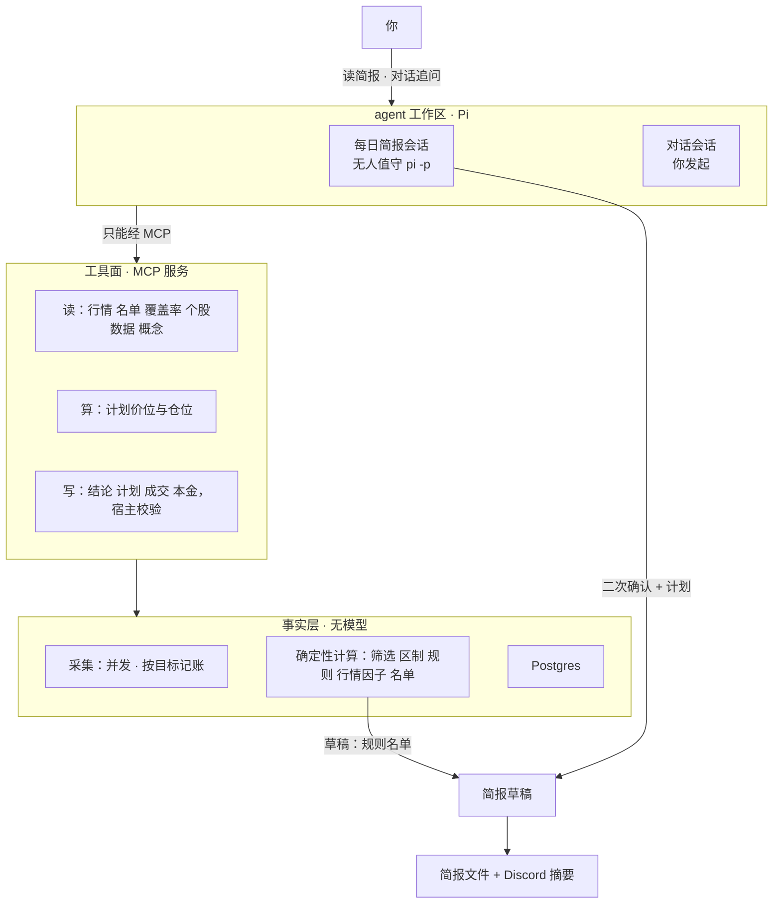

# Agent 优先重做（v3）设计

> 状态：用户已于 2026-11-05 批准。写成后只增不改。
> 本文推翻 v2.x 的路线（[roadmap](../roadmap/roadmap.md) §3–§5），不是在其上追加一版。批准后旧系统按 §10 下线。
> 文中「用户决定」是用户在 2026-11-05 的讨论里明确说的；「我的判断」是设计者替用户做的默认选择，用户可以推翻；两者不混写。

---

## 1. 为什么重做

**用户原话（2026-11-05）**

- 问题：workflow 太长，运行时间长并且很多降级状态；数据展示太多，没有入口推进概念学习。
- 目标：投研 AI 智能体。目前系统更像混合态；ChatGPT 调用太弱、经常回复失败，考虑改成本地 CLI；入口希望是 agent，由 agent 告诉我今天行情以及下一步可以关注什么。
- 之后补充：先出草稿，目标是告诉我最近行情适合交易什么；希望产出个股，因为下一步是「agent 二次确认 + 输出交易计划」；这是个人项目，可以直接推翻重做；运行时用 Pi。
- 定稿前的回答：模型提供方要能输入或选择，因为可能会切换；走专门的 Pi 配置目录；旧 roadmap、feature 全部归档，本次是 v3 版本开始。

**2026-11-05 对真实库的只读核实**

| 现象 | 数据 |
|---|---|
| 每日运行从未干净跑完 | 15 条 `daily` 执行记录：11 条 degraded、4 条 error、0 条 success |
| 运行时间长 | 最近三个定时日 23.0、23.3、34.5 分钟；`collect` 单节点 903–1000 秒（138 个目标顺序拉取，没有并发） |
| 「降级」没有信号意义 | 11-05 有 8 只日线 SSL 失败，`collect` 记 partial，整天记 degraded；`collect` 13 次里 12 次 partial |
| 推送连续两天没发出 | 11-04、11-05 的 `push` 都是 Discord 413（消息超长），根因未查 |
| 模型调用失败多为自家问题 | ChatGPT 59 次调用、20 次失败：13 次是代码 bug（其中 11 次 `KeyError: 'research_not_cited'`），6 次网络错误、1 次超时；模型客户端 `max_retries=0`，`retryable` 标记没有代码消费 |
| 人实际用的只有对话 | 真实账户：成交 0、资金快照 0、出入金 0（库里 4 笔成交都是模拟账户由宿主生成的）；补充信息 0、备注 0、研究请求 0、我的知识 2；讨论 3 个共 10 轮 |
| 计划从未算出股数 | 最近 30 份计划的仓位状态都是 `no_equity`：没有资金快照，系统不知道本金 |
| 规模 | 458 个 Python 文件、154 个前端 TS 文件、31 个迁移、约 60 张表；日图 13 个节点 |

结论：agent 现在是 13 节点流水线里的一个节点，人面对的是 12 个分区的看板。重做把它倒过来——人面对 agent，流水线退成安静的事实层。

---

## 2. 目标、非目标、反目标

**目标**

1. **入口是 agent**（用户决定）。每天一份简报回答「最近行情适合交易什么」，落到个股；之后可以在同一个工作区对话追问。
2. **先出草稿**（用户决定）。草稿是规则算出的个股名单，不调模型，事实任务一结束就存在。
3. **自动取前几只做二次确认并输出交易计划**（用户决定自动取；取 5 只是我的判断）。
4. **运行短、状态诚实**。采集并发；失败按目标记账，以「覆盖率」句子出现在简报里，不再有运行级的「降级」。
5. **概念学习有入口**。方向见 §8，细节另行讨论。
6. **规模大幅下降**。删除的代码与表见 §9。

**非目标**

- 券商接入、自动下单、盘中行情（沿用旧边界）。
- 模拟账户、组合经理、复盘卡、我的知识、系统内 roadmap、优化提案、功能开关。
- Web 看板（含 K 线图）。
- 适配多个 agent 运行时。只做 Pi；工具面用 MCP，保留以后换运行时的可能，但本次不验证其他 CLI。
- 把旧的计划、版本链、Agent 运行记录、模拟账户成交迁到新表。
- 扩大筛选范围到纳指 100 以外（列为后续，见 §10）。

**反目标**（即使功能都在，出现这些也算失败）

- 模型不可用时草稿也没有。
- agent 能给出没经宿主校验的价位或仓位，或者给规则名单以外、用户也没点名的股票出计划。
- 「一只股票没拉到」被显示成「今天降级」。
- 重做过程中丢失 Postgres 里的行情、资讯、申报等事实数据。
- 简报写成投资建议的口吻。所有规则未经验证，简报必须在页脚写明，并标出数据截止时点。

---

## 3. 约束

- **运行环境**：本机 macOS、单用户；Postgres 保留为唯一状态存储；出网经 `127.0.0.1:1082` 代理，该代理会间歇失败。
- **Pi**（2026-11-05 核对）：1.5.0，`~/.local/bin/pi` 是指向 `~/.pi/agent/bin/pi` 的启动脚本；它需要 `node`，本机的 `node` 在 `~/.local/bin`。两者都不在现有 LaunchAgent 的 `PATH`（`/opt/homebrew/bin:/usr/bin:/bin:/usr/sbin:/sbin`）里。
- **Pi 里可用的模型提供方**：`openai`（OAuth，即 ChatGPT 订阅，登录态在 `~/.pi/agent/auth.json`）；`cc-switch-zhipu-glm`（自定义提供方，`glm-5.3`、`glm-5.3-flash`，定义在 `~/.pi/agent/models.json`）。用户决定不写死，做成可以输入或选择的设置（§7「模型设置」）。Pi 换的是运行时（agent 循环、重试、会话），不换模型：选 `openai` 就仍是旧系统用的那个订阅。
- **用户级的 Pi 扩展会进入无人值守会话**：`~/.pi/agent/settings.json` 装了 14 个包（含 superpowers、pi-subagents、pi-web-access、pi-lens）。简报会话必须把它们全部关掉。
- **用户级的 MCP 服务也会被连上**：Pi 把 `~/.pi/agent/mcp.json` 和项目配置一起读，会话开始就连接其中所有服务；工具允许名单只挡工具声明，挡不住服务启动。该文件现在不存在，但用户以后加了就会生效。
- **配置目录可以整体换掉**：环境变量 `PI_CODING_AGENT_DIR` 把 Pi 的配置目录从 `~/.pi/agent` 改到别处，扩展、skill、MCP 配置、登录态都跟着换。
- **Pi 没有操作系统级沙箱**：「禁用工具」只是不向模型声明。工具面必须靠允许名单收窄到本项目的 MCP 工具。
- **Pi 的 MCP 配置只能走文件**（`~/.pi/agent/mcp.json` 或项目内 `.pi/mcp.json`），没有命令行参数；项目内配置要项目被信任才读。
- **Pi 的退出码不可靠**：失败的助手回复不一定带来非零退出码，成败要读事件流（[可行性报告](../roadmap/v2.8-runtime-feasibility.md) §4，针对 1.4.0；1.5.0 的文档仍如此描述）。
- **规则未经验证**（Phase 0 Gate HOLD 仍然成立）。
- **仓库约定**：主干开发；spec 在 `docs/specs/`、plan 在 `docs/plans/`，写成后只增不改；plan 按层合并 Task，测试分级，每 Task 一轮审查。

---

## 4. 做法比较

| 做法 | 内容 | 结论 |
|---|---|---|
| A 留在一条链里 | 13 节点不动；筛选加行情因子，agent 节点只取前 5 只，推送模板换成草稿 | 改得最少，但采集仍在链上占 15 分钟，单目标失败照样染黄全天，草稿仍等模型。未选 |
| B 拆成两个任务 | 事实任务（无模型）+ 简报任务（宿主编排 agent 步骤） | 设计者最初推荐。未选 |
| **C agent 运行时主导** | 事实任务同 B；简报由一个 agent 会话自己决定调哪些工具，对话入口共用同一运行时 | **用户选定**，并允许推翻重做 |

用户选 C 之后的两点修正：

- 设计者最初反对 C 的理由是「先后顺序交给模型，与『判定在宿主』冲突」和「不解决现有失败原因」。允许重做后，自家代码 bug 随旧代码消失，CLI 自带的重试补上零重试的缺口。「判定在宿主」换一种方式保留：顺序交给 agent，数字和落库由工具把关（§6）。
- 从 B 里保留一点：草稿在 agent 会话开始之前发布，所以草稿不等模型（§5.3）。

**运行时：Pi**（用户决定）。用户先选了本地 Claude Code CLI，同日改为 Pi。三个 CLI 的实测对比见可行性报告。

---

## 5. 目标架构

### 5.1 一天的流程

一个 LaunchAgent 定时启动一条命令（本文记作 `ia daily`，命名留给实施者），顺序做四件事：

1. **采集**（§5.2）。
2. **确定性计算并发布草稿**（§5.3、§5.4）。到这一步草稿已写库、写文件。
3. **简报会话**（§7）：启动 `pi -p`，agent 对名单前 5 只做二次确认并保存结论与计划，再写「一句话」总结。
4. **发布**：合成最终简报，写文件，发 Discord。

第 3 步失败或超时不影响第 2 步的产物：最终简报里名单照常，结论处写「二次确认未完成」和原因。

默认时间沿用现状：北京 11:30，周二至周六（我的判断：不改变用户现有习惯；可配置）。新旧并行期的时间见 §10。

### 5.2 事实层：采集

- **复用**：`data/` 整层（九族适配器、`registry.run_adapter`、`fetch_policy`、`data_fetch_runs`）。
- **目标集合**：纳指 100 范围文件、关注列表、真实持仓、基准与行业 ETF。现在这段逻辑在 `workflow/targets.py` 与 `workflow/nodes/collect.py`，依赖将被删除的层，需要重写成一个不依赖 `workflow` / `analysis` 上层的精简驱动。
- **并发**：逐只的族（日线、资讯、财报日、SEC 列表）用有上限的工作池并发拉取。现状是顺序拉取。验收目标见 §12。
- **行业 ETF 扩充**（我的判断）：现有只有 QQQ、SMH、XLK，全是科技。加入其余 SPDR 行业 ETF（XLV、XLY、XLP、XLE、XLF、XLI、XLB、XLU、XLRE、XLC），日线适配器不用改。
- **记账**：每次拉取仍写 `data_fetch_runs`，目标级明细不变。**没有运行级状态**。由拉取记录推出「覆盖率」：每族拿到多少 / 应拿多少、缺哪些目标、原因。
- **唯一会让当天没有草稿的情况**：数据库不可达，或基准 SPY 当期日线缺失。此时写一份只有原因的简报并通知。

### 5.3 事实层：确定性计算与草稿

依次算（全部是已有纯函数或其薄封装，不调模型）：

1. 筛选 `screen-1`（`analysis/screen_rules.evaluate`）。
2. 区制与广度 `regime-2`（`analysis/regime.snapshot`、`derivation/indicators/breadth`）。
3. 规则候选（`analysis/rules.evaluate`）。
4. 三个行情因子（§5.4，新增）。
5. 名单排序（§5.4，新增），写入当期名单表。
6. 持仓状态：由 v3 的成交记录算持仓（`execution/positions.build`），对照最新收盘给出每只持仓的盈亏与距止损距离。只列事实；没有成交记录时这一段写「没有持仓记录」（我的判断：v3 首版不让 agent 每日复查持仓）。

草稿 = 市场环境 + 名单（每只一行规则理由）+ 持仓 + 覆盖率。草稿在这里写库并写文件。

### 5.4 规则名单（第一步，纯规则）

**用户问过「用规则限定，还是规则 + agent」。结论：名单由纯规则决定，agent 不能增删名单；agent 在第二步有否决权，没有提名权。** 用户没有反对并继续推进，按此设计。理由：

- 二次确认要独立，第一次就不能是 agent 自己选的。
- 规则名单可复现，才能回头检验「适合」说得对不对。
- 草稿不因模型失败而缺席。

**候选池**：`screen-1` 当期入选（触发组 + 形态组，上限 20）。

**三个行情因子**（新增的确定性指标，每个给出原始数字、样本量和一个档位：有利 / 中性 / 不利 / 样本不足）：

| 因子 | 定义 | 样本不足的条件 |
|---|---|---|
| 形态近期表现 | 对每条买入类规则，在范围内回放最近若干交易日的触发，统计触发后固定持有期的涨跌：次数、上涨占比、平均涨跌幅 | 触发次数低于下限 |
| 行业强弱 | 按 `sector_classifications` 的行业组，统计组内站上 50 日线的占比与相对 SPY 的 20 日强弱中位数，在各组间排名 | 组内成员少于 3 只 |
| 区制 | `regime-2` 标签：risk_on 有利、neutral 中性、risk_off 不利、insufficient 样本不足 | 沿用区制自身的判定 |

**排序**：触发组在前、形态组在后（沿用 `screen-1`）；组内依次按「所触发规则的形态近期表现档位」「所在行业档位」「相对强弱」排序。区制对所有股票相同，只出现在草稿抬头，不影响名次。

**先排序、不过滤**（我的判断，用户没有反对）：三个因子只决定名次和标签，不把任何股票挡在名单外。原因是样本太小——截至 11-04，趋势回踩修复只有 6 次触发，拿它一票否决是在拟合噪声。

**每只股票在草稿里的一行**：触发规则、三个因子的档位与原始数字（含样本量）、相对强弱。例：`IDXX · 放量突破 · 形态近期有利（19 次 13 涨，+2.7%）· 医药化工 有利 · RS 0.35`。

**与旧原则的关系**：旧 roadmap 把「大池子历史回测」「用历史数据调参数」列为永久不做。形态近期表现是最近窗口的描述统计，只用于排序和展示，不反推任何参数；档位阈值是固定的默认值，写在配置里并标明未经验证。

2026-11-04 的手工样例（证明现有数据足以拼出草稿）：区制 neutral；SPY 20 日 -1.3%、QQQ -8.7%、SMH -19.3%；纳指 100 范围内放量突破 12 只触发，集中在医药化工（AMGN、GILD、IDXX）、批发零售（AMZN、ORLY、ROST）、仪器与其他制造（GEHC、ISRG、ROP），电子 12 只里 0 只；此前的放量突破 19 次里 13 次上涨、平均 +2.7%，趋势回踩修复 6 次里 1 次上涨、平均 -4.4%。

---

## 6. 工具面（MCP 服务）

一个本地 stdio MCP 服务，由 Pi 按配置文件拉起。它是 agent 接触数据的唯一途径。

**启动参数由宿主写进配置，模型改不了**：交易日（数据截止时点）、模式（`brief` 或 `chat`）、会话编号。所有读工具只返回该交易日收盘及之前入库的数据。

**返回要紧凑**：Pi 会把过大的工具结果截断中段（1.4.0 实测约 20 KB）。读工具限制回看长度，返回摘要而不是整表。

| 类 | 工具（名称留给实施者，职责如下） | 来源 |
|---|---|---|
| 读 | 市场环境（区制、广度、行业 ETF 强弱、宏观） | 新封装 |
| 读 | 当期名单（含因子、理由、每只是否已有结论）、覆盖率 | 新 |
| 读 | 日线、指标、资讯、申报、财报日、基本面、持仓 | 现有 `analysis/agent/tools.py` 的对应函数改写 |
| 读 | 概念卡、已保存的简报与计划 | 现有 `core/knowledge` + 新 |
| 算 | 计划价位与仓位：入场区间、止损、目标、按风险预算的股数 | 现有 `execution/plan_levels`（`rule_levels`、`size`、`validate_levels`）与 `entry_rules` |
| 写 | 保存二次确认结论（确认 / 否决 / 无法判断，理由、反证、引用的工具调用） | 新 |
| 写 | 保存交易计划 | 新，校验见下 |
| 写 | 记录成交、记录账户本金（仅 `chat` 模式，§8） | 新的精简实现 |
| 取数 | 给名单外的股票补数据（仅 `chat` 模式，§8） | 现有适配器 |

**保存计划时宿主校验**（任何一条不过就拒绝并返回原因，agent 可以改了再存）：

1. 标的范围：`brief` 模式只接受当期名单前 N 只；`chat` 模式另接受用户点名的股票，计划标记来源为「用户点名」。模式来自启动参数，不来自模型。
2. 该标的必须先有一条「确认」结论。
3. 价位：默认取宿主算的规则价位；agent 可以提出自己的价位，但必须通过宿主的价位校验（顺序正确、止损在入场下方、相对最新收盘与 ATR 在合理范围内）。
4. 仓位永远由宿主算，agent 不能指定股数。
5. 入场类型与最长持有在允许范围内。

**结论与计划按「交易日 + 标的」幂等**：同一交易日同一标的再次保存，覆盖为最新一份并保留工具调用记录。重试时已经有结论的标的不重做（§7）。

**仓位的本金与风险参数**（我的判断）：

- 风险参数（单笔风险占比、单票上限、总仓位上限）放在配置文件，默认取现有 `WorkbenchConfig` 的值。
- 本金取用户最近一次记录的账户本金。现状是从未记录过，所以旧系统的计划一直没有股数。v3 里用户在对话中说一句账户金额，agent 调用记录本金的工具即可；计划上显示本金的记录日期。
- 没有本金记录时，计划照常保存，股数处写「未提供账户资金，未算股数」，只给每股风险。这不算失败。

**每次工具调用记一行**（会话、工具、参数、结果摘要哈希、时间）。结论与计划里的引用指向这些行，简报里能查到 agent 看了什么。

---

## 7. Agent 工作区与每日简报会话

**工作区**：仓库里的一个目录，放 agent 的说明文件、操作手册（playbook）、skill 和 Pi 的项目配置。说明文件规定：只引用工具返回的数字；每个判断给出理由和反证；中文；不给规则名单以外的股票出计划；简报页脚写明规则未经验证。

**操作手册只有一份正文**：无人值守运行把它作为提示词传入，交互会话把同一份文件包成 skill。两处不各写一份。

**无人值守调用**（宿主用子进程启动；下面每一条都要在 §10 的第 0 步用 Pi 1.5.0 实测确认）：

- 绝对路径的 `pi -p --mode json`，显式环境（`HOME`、含 `~/.local/bin` 的 `PATH`、代理变量），`stdin` 关闭，不保存会话。
- **隔离用户配置**：无人值守会话用一个专用的 Pi 配置目录（用户决定；通过 `PI_CODING_AGENT_DIR` 指定），里面没有扩展、skill 和用户级 MCP 服务，登录态也独立。用户需要在这个目录里登录一次；要用自定义提供方（如智谱）时，把它的定义也放进这个目录。作为第二道保险，命令行上仍然关闭扩展发现、只显式加载内置 MCP，关闭 skill、提示词模板、主题、上下文文件的自动发现。工作区自己的说明文件由宿主显式传入，不靠自动发现（Pi 会沿父目录找 `AGENTS.md` / `CLAUDE.md`，仓库根的 `CLAUDE.md` 是开发约定，不能进简报会话）。
- **工具允许名单**只含本 MCP 服务的工具，内置的读写文件、shell 等一概不声明。
- **MCP 配置**：宿主为每次运行生成一个临时工作目录，写入 `.pi/mcp.json`（含交易日、模式、会话编号等启动参数；工具暴露方式设为直接暴露），并以信任本次运行的方式启动。
- **提供方与模型每次都由宿主显式传给 Pi**，取自下面的「模型设置」，不依赖 Pi 自己的默认值。
- **成败判定不看退出码**。以宿主自己的记录为准：会话结束后，名单前 5 只各自有没有结论。事件流里最后一条助手消息的停止原因和收尾事件只用来写失败原因。
- **时间预算**：简报会话总预算 20 分钟（含重试，我的判断）。超时杀进程。若还有标的没有结论且预算有剩，再启动一次，只处理剩下的标的。
- **token 用量**：把事件流里每条助手消息的用量累加，连同耗时记入简报页脚。
- **同一时刻只跑一个无人值守的 Pi 进程**。多个 Pi 进程同时刷新同一份 OAuth 令牌会不会互相覆盖，没有验证过。用户的交互会话和无人值守会话如果共用 `~/.pi/agent/auth.json`，这个风险在用户恰好在定时运行前后对话时仍然存在；专用配置目录各有各的登录态，可以避开。

**模型设置**（用户决定：提供方不写死，要能输入或选择，因为可能会切换）

- 提供方和模型是系统的一项设置，没有内置默认值；首次安装时由用户选定。
- 提供一条命令来改它：列出专用配置目录里当前可用的提供方与模型供选择，也可以直接输入。保存前检查该提供方在专用目录里是否已登录或已定义，不可用就拒绝并说明原因。
- 单次运行可以临时指定另一个模型，不改设置。
- 每份简报记下所用的提供方与模型并显示在页脚，切换前后的简报可以对照。
- 切换只影响之后的运行；对话会话用的是用户自己的 Pi 配置，不受这项设置影响。

**agent 在简报会话里做什么**

1. 读市场环境、名单、覆盖率。
2. 对名单前 5 只逐只二次确认：读日线与指标、资讯、申报、财报日、基本面；判断规则给的理由是否成立，找反证（例如突破是不是并购消息造成的、几天内是否有财报、成交量是否异常）。给出结论：
   - **确认**：算价位、保存计划（入场方式与区间、止损、目标、股数、最长持有、作废条件、论点与反证）。
   - **否决**：写明原因，不出计划。
   - **无法判断**：写明缺什么数据，不出计划。
3. 写「一句话」总结：最近行情适合交易什么。只能概括名单和结论，不能引入名单外的股票。

单会话完成，不设独立的反方 agent，不用子代理（我的判断：先看单会话的质量，再决定要不要加）。

**最终简报的结构**

1. 一句话（agent）
2. 市场环境（事实）
3. 适合交易什么：名单前 5 只，每只一行规则理由 + agent 结论与理由；其余入选股票只列规则理由
4. 交易计划：被确认的股票
5. 持仓（事实）
6. 今天下不了结论的：覆盖率、未完成的二次确认及原因
7. 今日概念（§8，第 4 步交付后才有）
8. 页脚：数据截止时点、规则未经验证且不构成投资建议、所用模型、token 用量与耗时

**产物**：简报写库，并在运行目录写一份 Markdown 文件；Discord 发摘要（一句话、名单前 5 只与结论、计划各一行、文件位置）。Discord 消息按长度上限分条，由构造保证不超限。每天只推送一次，在第 4 步（我的判断：不为草稿单独推一次）。

---

## 8. 对话追问与概念学习

**对话追问（第 3 步）**：用户在工作区目录启动 Pi 的交互界面，MCP 服务以 `chat` 模式接入（工作区的项目配置，用户信任一次）。交互会话用的是用户自己的 Pi 配置，他装的扩展照常加载，本设计不干预。能做的事：

- 就当天简报追问（为什么选它、为什么否决）。
- 点名一只股票做同样的二次确认与出计划。名单外的股票先用取数工具补数据。
- 口述成交，由 agent 调用记录成交工具；写入前把要记的内容复述一遍，用户确认后才写。记成交时可以指明照的是哪一份 v3 计划（可选，我的判断：留着这个关联，日后才能检验计划）。
- 口述账户本金，用于算股数（§6）。

**概念学习（第 4 步）——方向已定，细节未与用户讨论，实施前要单独开一次设计讨论**

- 方向：简报里出现的一两个概念标为「今日概念」，用当天的真实例子讲；另有一份讲概念的 Pi skill，参照用户已有的「交互式课程 + 离线课程页」模式（他在 Claude Code 里的 `guokao-sprint`、`interview-sprint`）。
- 教材：现有 129 张概念卡里，讲交易概念的约 40 张（指标 15、规则 10、计划 15）可以复用；其余 89 张讲的是旧系统自身的机制（系统 25、复盘 24、agent 23、数据族 9、账户 8），随旧系统归档。
- 未定：学习进度怎么记、要不要测验、课程页长什么样。

---

## 9. 保留与删除

**保留**

| 内容 | 说明 |
|---|---|
| Postgres 事实表 | 日线、资讯、申报、财报日、宏观、行业归类、基本面观察、拉取记录、关注列表 |
| `core/` 的底座 | 事务、数据库工具、HTTP、脱敏、常量；文案与口径版本表按需裁剪 |
| `data/` 整层、`derivation/` 整层 | 适配器、注册表、22 项指标 |
| 纯函数 | `analysis/rules.py`、`screen_rules.py`、`regime.py`、`pool.py`；`execution/plan_levels.py`、`entry_rules.py`、`positions.py` |
| Discord 发送 | `notify/` 里的发送通道；模板重写 |
| 交易概念卡 | 约 40 张 |

保留模块原地裁剪而不是另起一个包（我的判断）：这几层本来就只向下依赖，且有测试。个别模块有向上的 import（例如 `core/knowledge.py` 依赖 `core/stages`，`screen_rules.py` 引用 `execution`），裁剪时解开。

**删除**

- `workflow/`、`views/`、`api/`、`services/`、`tasks/`、`review/`、`optimize/`、`analysis/agent/`、`core/llm/`、`execution/paper/` 以及 `execution`、`analysis` 里与计划链、账户、研究请求相关的模块。
- `web/` 全部。
- LangGraph、SIWC（Sign in with ChatGPT）模型层及其依赖。
- 对应的测试、功能文档、设计标准文档。
- 旧表，包括 `accounts`、`trades`、`account_snapshots`、`cash_flows`：真实账户在后三张表里没有任何行，库里的 4 笔成交都属于模拟账户，所以没有用户数据要迁。删除前先 `pg_dump` 备份，再由一个迁移删除；迁移要先处理指向这些表的外键（迁移 027、029、030 加的）。

**新增的表**（数量与字段留给实施者；职责如下）：当期名单与因子、简报、二次确认结论、交易计划、成交、账户本金记录、工具调用记录。迁移编号接着现有的往后排。

---

## 10. 顺序与切换

每一步各写一份 plan；第 1、2 步可以合成一份。

| 步 | 内容 | 完成的标志 |
|---|---|---|
| 0 | **可行性验证**（一次性，先做）：建好专用的 Pi 配置目录，用户在其中登录一次并选定模型；然后在 launchd 环境下用 Pi 1.5.0 跑通 §7「无人值守调用」的每一条 | 一条命令在 launchd 下返回 MCP 工具调用的结果；事件流里只出现本服务的工具；让模型读一个本地文件、访问一个网址都失败；上下文里没有用户扩展和仓库根 `CLAUDE.md` 的内容；拿到 token 用量；故意让提供方失败时宿主能判出失败 |
| 1 | 事实层与工具面 | 采集、计算、名单命令可独立运行；MCP 服务通过工具级测试 |
| 2 | 每日简报 | 定时运行产出最终简报并推送 |
| 3 | 对话追问 | 点名出计划、口述记成交与本金可用 |
| 4 | 概念学习 | 另行设计 |
| 5 | 旧系统下线 | 旧 LaunchAgent 卸载，旧代码与旧表删除，文档归档 |

- **新旧并行期**：事实表是共用的，新旧两边都会写；写入必须幂等（实施者核对现有写入是否满足）。各自的业务表互不相写。两边都要过同一个代理拉数据，所以并行期新系统的定时时间与旧系统错开（旧系统 11:30 起跑、约半小时结束；新系统并行期定在 12:30，切换后改回 11:30）。
- **切换条件**：第 2 步连续 3 个定时交易日无人工干预产出简报后，卸载旧服务。
- **旧系统的两个 bug**（推送 413、`research_not_cited`）默认不修。
- **第 0 步失败的退路**：如果无人值守的登录、隔离或成败判定走不通，回到用户面前重新选运行时，不在本设计内自行替换。
- **版本**：本次是 v3 的开始（用户决定）。切换完成时的发布记为 `v3.0.0`；打 tag 与 push 仍需用户单独授权。
- **文档归档**（用户决定：旧 roadmap、feature 全部归档）：`docs/roadmap/` 整个目录（含各版验收记录与可行性报告）和 `docs/features/` 整个目录移入 `docs/archive/`。同时归档 `architecture.md`、`design-system.md` 和讲旧系统机制的 89 张概念卡（我的判断：它们描述的同样是 v2）。归档在 v3 实施的第一个 Task 里做（我的判断：既然 v3 从现在开始，不等到切换）。`docs/operations/` 在旧服务卸载前保留，切换时重写。冻结的 spec / plan 里指向被移动文件的链接按仓库约定只修链接、不改正文。
- **新的 roadmap**：仓库里一份简短的 v3 路线文件，列出本文 §10 的各步及其状态，直接改文件维护。
- **`CLAUDE.md`**（用户已同意改写）：「Roadmap 记录」那条改为「roadmap 是仓库里的文件，直接修改」，与文档归档在同一个提交里改。
- **后续（不在本设计内）**：筛选范围扩到纳指 100 以外；独立的反方 agent；agent 每日复查持仓；K 线图嵌入简报。

---

## 11. 定稿前问用户的问题与回答（2026-11-05）

| 问题 | 用户的回答 | 落在哪里 |
|---|---|---|
| Pi 的无人值守会话用哪个模型提供方（本机现有 ChatGPT 订阅与 cc-switch 的智谱 `glm-5.3`） | 不固定一个；用系统里的输入或选择来定，因为可能会切换 | §7「模型设置」、验收 12 |
| 无人值守会话是否用专用的 Pi 配置目录 | 用专门的 Pi 配置目录 | §7「隔离用户配置」、§10 第 0 步 |
| 是否同意改写 `CLAUDE.md` 的 roadmap 约定并归档旧 roadmap | 可以；所有旧 roadmap、feature 都归档；本次是 v3 版本开始 | §10 |

没有遗留的待答问题。

---

## 12. 验收

| # | 标准 |
|---|---|
| 1 | 事实任务（采集 + 计算）在网络正常的交易日 5 分钟内完成（目标值，未实测；实测后写回） |
| 2 | 把 `pi` 路径指向不存在的文件再跑：草稿照常产出，最终简报写明「二次确认未完成」与原因，Discord 照常收到 |
| 3 | 名单前 5 只每只都有结论（确认 / 否决 / 无法判断）或明确的失败原因 |
| 4 | 保存计划的五条校验各有一个被拒绝的测试：名单外标的、没有确认结论、止损不在入场下方、指定股数、入场类型越界 |
| 5 | 同一份入库数据重算，名单与排序完全一致 |
| 6 | 8 只日线缺失的那种日子：简报第 6 段列出缺失的股票，没有任何「降级」字样的运行状态 |
| 7 | Discord 消息在长度上限附近的边界测试通过 |
| 8 | 简报会话的事件流里只出现本 MCP 服务的工具，没有连接任何用户级 MCP 服务，上下文里没有用户扩展、用户 skill 和仓库根 `CLAUDE.md` 的内容 |
| 9 | 没有本金记录时计划照常保存并写明未算股数；记录本金后同一标的重算能得到股数 |
| 10 | 会话在处理完 3 只后被杀掉：重试只处理剩下的 2 只，已有的结论不变 |
| 11 | 连续 3 个定时交易日无人工干预产出简报 |
| 12 | 用模型设置命令切到另一个可用的提供方后，下一次运行用的是新模型，简报页脚如实显示；选一个专用目录里不可用的提供方会被拒绝并说明原因 |

---

## 13. 留给实施者

- 命令、包、表、工具的命名；保留模块是否重组目录；工作区放在仓库内还是仓库外。
- 采集并发度、形态近期表现的回放窗口与持有期、样本下限、档位阈值的具体取值（要求：写在配置里、有默认值、在草稿里连同样本量一起显示）。
- 操作手册的具体措辞与输出格式；一份正文同时供无人值守与交互使用的实现方式。
- Pi 的具体命令行参数组合（以第 0 步实测为准）；思考强度的取值。
- 专用 Pi 配置目录的位置；模型设置存在哪里、设置命令的交互形式。
- 简报文件的存放位置；Discord 消息的分条方式。
- MCP 服务如何拿数据库连接（环境变量或启动参数）。
- 新表的字段；删除旧表的迁移何时执行（必须在备份之后、切换之后）。
- 测试分级沿用仓库约定：每个 Task 只跑相关测试，全量只在收尾跑一次（前端删除后只剩后端两套）。

---

## 14. 审阅记录

2026-11-05 由一名独立审阅者以「拿到文档就要排实施计划」的角度读过一遍（当时运行时写的还是 Claude Code CLI）。它提出的问题与处理：

| 问题 | 处理 |
|---|---|
| 仓位按什么本金和风险参数算 | §6「仓位的本金与风险参数」；并核实了真实账户没有任何快照 |
| `trades` 上的外键与账户列；新成交要不要关联 v3 计划 | §9 删除旧表并写明外键；§8 记成交可关联计划 |
| 并行期事实表由谁采集 | §10「新旧并行期」 |
| 重试时已保存的结论怎么算；总时长 | §6 幂等、§7 时间预算、验收 10 |
| 「真实账户」怎么识别 | 真实账户在相关表里没有行，不再需要识别 |
| 对话会话用哪套配置 | §8：用用户自己的 Pi 配置 |

运行时改成 Pi 之后，同一位审阅者对照 Pi 1.5.0 自带文档补看了改动的章节，没有发现与文档直接矛盾的描述，另提两条：

| 问题 | 处理 |
|---|---|
| 用户级 MCP 服务仍会被连上，命令行参数和工具允许名单挡不住 | §3 补充事实；§7 用专用配置目录（用户已同意）；验收 8 |
| 交互会话与无人值守会话共用登录态，令牌并发刷新的风险仍在 | §7；专用配置目录可避开 |
