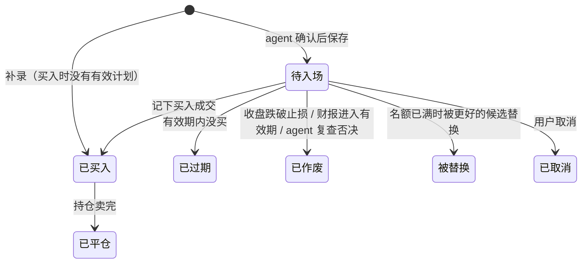

# v3.1.0 设计：每日简报、连贯的交易计划、止损纪律、账户、页面与对话

> 状态：待用户批准。写成后只增不改。
> 与 [v3 设计](2026-11-05-agent-first-rebuild-design.md)（下称「v3 设计」）的关系：本文把 v3 设计的第 2 步（每日简报）和第 3 步（页面服务与对话）合成一个版本交付，并新增三样 v3 设计里没有的东西：跨天的计划线、止损纪律、账户。v3 设计没被本文改动的部分仍然有效；改动之处逐条列在 §17，冲突时以本文为准。
> 文中「用户决定」是用户在 2026-11-06 的讨论里明确说的；「我的判断」是设计者替用户做的默认选择，用户可以推翻；两者不混写。
> 实施方式（用户决定）：本文批准后不由设计者直接实施，由本机 Pi（模型 `glm-5.3`）在仓库目录实施。

---

## 1. 为什么做这一版

**用户原话（2026-11-06）**

- 「我想增加 web 入口，一是可以看简报、二是可以和 agent 对话。」
- 「我想先把账户、交易计划这块做起来；这样我就能开始根据计划做实际交易，agent 也能看到仓位、盈利情况。」
- 问到买入之后希望系统每天做什么：「检查下次开盘卖出？以什么价位。」
- 问到是否愿意在券商挂止损单：「都可以，以你认为的最优解即可；因为目前的交易操作的确有很多没有及时止损导致的亏损放大，我希望规避这个问题。」
- 问到已有持仓要不要录进来由系统盯止损：「可以考虑。」
- 问到 v2 时为什么一笔成交都没记：「还用不起来，因为信号太多并且没有连贯性，我不知道信号是否还生效，如果变化是因为什么而变化的。」
- 问到每周实际下手几笔：「0-2 笔都可能，我主要做的是周级波段，不会做超短线。」
- 对「待入场计划最多 3 份」：「如果有更优解可以替代。」
- 对页面：「你直接按照你的理解定一版即可，后续我再慢慢微调；只要思路对就行。」
- 对交付方式：「方案二吧，直接一个迭代交付。」
- 版本：用户说「v3.0.0 已经在最后的收尾工作」。我的理解：v3.0.0 的范围是 v3 设计的第 0、1、5 步（事实层、工具面、移除 v2），本文是 v3.1.0。

**2026-11-06 对现有代码的核实**

| 现象 | 依据 |
|---|---|
| 计划之间没有跨天的关联 | `v3_plans` 按 `(session, ticker)` 唯一并原地覆盖；`facts/` 与 `toolsurface/` 里没有任何读「上一个交易日」的代码 |
| 一周最多 25 份计划 | 每天名单前 5 只各自可以出一份计划（`V3Config.top_n = 5`） |
| 计划很快过期 | `plan_levels.VALID_SESSIONS = 3`（T+1 至 T+3）；`save_plan` 的最长持有缺省 10 个交易日 |
| 买入之后没有任何卖出判断 | 草稿的持仓一节只列数量、成本、盈亏比例、距止损距离（`facts/holdings.py`），止损取该股票最新一份计划的止损价，不随时间变化 |
| 账户只有一个口述的数 | `v3_equity` 是本金快照；没有现金、出入金、已实现盈亏 |
| 没有面向人的产出 | 没有定时、没有简报会话、没有推送；服务外壳只托管占位页 |
| 关注列表没有写入口 | 只能直接写 SQL（见 CHANGELOG「第 5 步提前」） |

结论：按 v3 设计原样做第 2、3 步，会在新系统里重现用户在 v2 遇到的问题（信号多、不连贯、不知道是否还生效、不知道为什么变）。所以这一版的重心是**一份计划从出现到结束的完整记录**：止损纪律、账户和连贯性都挂在它上面。

---

## 2. 目标、非目标、反目标

**目标**

1. **每日简报定时产出并推送**（v3 设计第 2 步）。
2. **计划是一条跨天的线**（我的提议，用户同意）。一只股票同时只有一份有效计划；每次状态或数字变化都记一行，写明日期和原因。
3. **止损纪律**（用户决定目标；做法是我的判断，用户同意）。买入即挂止损单；止损只上不下；止损触及而没有卖出记录时，每天排在第一行提醒，直到记下卖出。
4. **账户**（用户决定要做；做法是我的判断）。一个真实账户，系统按成交和出入金算出现金、总资产、浮动盈亏和已实现盈亏；agent 读得到。
5. **信号变少**（用户决定「如果有更优解可以替代」）。待入场计划最多 3 份，名额满时每天最多替换一份。
6. **页面**（用户决定要有看简报和对话两个用途；布局是我的判断）。一个页面四块：今日操作、今日简报、计划与持仓、对话。
7. **适配周级波段**（用户决定交易风格；取值是我的判断）。计划有效期 5 个交易日，最长持有缺省 20 个交易日。

**非目标**

- 券商接入、自动下单、盘中行情（沿用 v3 设计）。
- 模拟账户、多账户、融资融券、做空、期权。
- 加仓计划、到目标位分批止盈。加仓的成交可以记，但系统不为它出计划（§6.5）。
- 调整选股规则或价位算法的参数：筛选 `screen-1`、止损 2 倍 ATR、目标 4 倍 ATR 都不动。
- 自动处理分红。分红可以作为一笔出入金手工记。
- K 线图、概念学习（v3 设计第 4 步，另行设计）。
- 税务、币种换算（只有美元）。

**反目标**（即使功能都在，出现这些也算失败）

- 一只持仓的止损已被触及、系统里没有卖出记录，而当天的简报、Discord 或页面没有把它放在第一行。
- 持仓的止损价经任何途径被调低。
- 同一只股票同时存在两份有效计划。
- 计划的状态或数字变了，却查不到一行写明原因的记录。
- 持仓股票当天缺日线、止损没法检查，系统却没有说。
- 模型不可用时，草稿、持仓操作和止损提醒也跟着没有。这三样全部由宿主算，不依赖模型。
- agent 给出没经宿主计算或校验的止损价、卖出价或股数。
- 简报写成投资建议的口吻（沿用 v3 设计）。

---

## 3. 约束

v3 设计 §3 的约束全部沿用（本机单用户、Postgres、代理间歇失败、Pi 1.5.0 及其隔离要求、规则未经验证、仓库约定）。另外：

- **只有日线，每天收盘后跑一次**。系统看不到盘中。所有判断都是「用当天的 K 线，决定下一个交易日怎么做」。
- **Pi 的实测做法**以 [operations/pi-unattended.md](../operations/pi-unattended.md) 为准：专用配置目录 `~/.pi-ia`、实测通过的命令行、成败判定信号、多轮续接的参数。提供方与模型 id 只由宿主以命令行参数传入，不进任何仓库文件。
- **工具面的两条运维要求**沿用（[operations/v3-facts.md](../operations/v3-facts.md)）：`.pi/mcp.json` 的服务条目带 `"cwd": <仓库根目录>`；服务指向的库要有事实表。
- **迁移 033 还没在真实库执行**。本版的新迁移编号是 034，排在 033 之后；`migrate` 按顺序执行，且 033 待执行时带删表保护。所以真实库上线本版之前必须先执行 033，这需要用户授权（§15）。
- **只追加的表不许 `UPDATE` / `DELETE`**（`tests/test_no_update_on_append_only_tables.py`）。本版新增的记录类表沿用这个约定。
- **服务外壳的路由顺序**：新的 `/api/...` 路由必须在 `create_app()` 最后两个兜底路由之前注册（[operations/local-service.md](../operations/local-service.md)）。

---

## 4. 做法比较

**交付方式**（用户选定方案二）

| 方案 | 内容 | 结论 |
|---|---|---|
| 一 | 一个版本分两段交付：先交付计划线、止损、账户、简报和页面的前三块，再交付对话 | 设计者推荐，未选 |
| **二** | **全部做完一次交付** | **用户选定** |
| 三 | 拆成 v3.1.0 和 v3.2.0 两个版本 | 未选：内容与方案一相同，全量测试与审查各做两遍 |

方案二的代价是对话没做完之前其他部分也用不上。实施 plan 仍应把对话放在后面的 Task，使它出问题时不必返工前面的部分。

**止损怎么执行**（用户交给设计者定）

| 做法 | 结论 |
|---|---|
| 只在每天开盘按系统指令操作一次 | 未选。盘中跌穿止损要等到第二天开盘才卖，实际亏损可能大于「入场价 − 止损价」，仓位算法的前提不成立，也正是用户想规避的情况 |
| **买入后在券商挂止损单，系统每天给出这张单应该挂在多少** | **选定** |

**怎么限制信号数量**

| 做法 | 结论 |
|---|---|
| 按总风险预算限制（所有计划的潜在亏损之和不超过本金的某个比例） | 未选。更精确，但用户每天看不出还能再出几份计划 |
| **待入场计划最多 3 份，名额满时每天最多替换一份** | **选定**。总仓位上限照旧由仓位算法把关 |

**到目标位怎么办**

| 做法 | 结论 |
|---|---|
| 到目标位卖出一部分 | 未选（列为非目标）。要处理分批成交与剩余仓位的止损，复杂度高 |
| **到目标位不卖，改为移动止损** | **选定**。保留下来的概念卡 `plan.trailing_stop` 已定义这条规则 |

---

## 5. 一天的流程

一个 LaunchAgent 定时启动一条命令（命名留给实施者，本文记作 `daily run`），北京时间 11:30，周二至周六（沿用 v3 设计；v2 已移除，不必错开）。顺序做五件事：

1. **采集**。沿用现有的事实任务采集。现有目标已包含持仓的股票（`facts/collect.target_facts`）；新增待入场计划的股票，保证它们即使掉出股票池也有当天的日线。
2. **事实计算**。沿用现有的名单计算，结果不变。
3. **计划与持仓复查**（新增，宿主计算，不调模型）。见 §6、§7。产出：每份有效计划当天的状态变化、每只持仓下一个交易日的操作、名单的连续性标记。
4. **发布草稿**。草稿此时已包含第 3 步的全部结果，写库、写文件。
5. **简报会话**（agent）。见 §9。然后合成最终简报，写库、写文件，发 Discord。

第 5 步失败或超时不影响前四步的产物：最终简报里宿主算出的内容照常，agent 的部分写「未完成」和原因。

**当天没法算的情况**（数据库不可达，或基准 SPY 当期日线缺失）：照 v3 设计写一份只有原因的简报并通知。本版追加一条：如果此时有持仓，简报和 Discord 的第一行写「今天无法检查止损」和原因。

**同一交易日重跑**（例如美股休市日，最新已收盘交易日没变）：复查不产生重复记录；简报更新为最新一份；该交易日已经推送过成功的简报就不再推送。先推送过「当天没法算」的通知、之后重跑成功的，再推送一次成功的简报（我的判断）。

**漏跑的交易日要补查**（我的判断）：每份有效计划记着自己复查到了哪个交易日。每日任务对它从那之后的每个有日线的交易日按顺序逐日复查到 S，不只看 S 这一天。否则机器关机一天，那天盘中触及止损就永远查不到。补查出来的变化照常各记一行，日期写它实际发生的交易日。

**没有选定模型时**（设置项为空，§9.2）：前四步照常，第 5 步不启动会话，最终简报写「未选定模型，二次确认未做」。

---

## 6. 计划线

### 6.1 状态

- 「有效计划」指待入场或已买入。**一只股票同时最多一份有效计划**，由数据库约束保证，不只靠代码检查。
- 已过期、已作废、被替换、已取消、已平仓都是终态，不再变化。同一只股票之后可以有新的计划，是另一条线。

### 6.2 变化记录

计划的每一次变化记一行（只追加）：计划、交易日、类型、一句给人读的原因、变化前后的值、来源（宿主 / agent / 用户）、agent 引用的工具调用。页面上计划卡片的时间线、简报的「和昨天比变了什么」都从这里读。

例：

- `11-06 新建：放量突破，agent 确认（引用 3 次工具调用）`
- `11-09 延续：再次上榜第 2 天，价位不变，有效期延至 11-16`
- `11-10 修订：入场区间 31.80–32.10 改为 32.40–32.70，原因：……`
- `11-12 过期：5 个交易日未买入`
- `11-07 作废：收盘 30.95 跌破止损 31.20，未买入`

同一份计划、同一个交易日、同一类由宿主产生的变化只记一次（重跑幂等，§5）。

### 6.3 待入场计划每天的复查（宿主）

对交易日 S，按顺序检查，命中即停：

1. **作废：收盘跌破止损**。S 的收盘价低于计划止损价。
2. **作废：财报进入有效期**。沿用现有 `earnings_flags` 的 `earnings_in_validity` 判定，按 S 重新算。
3. **过期**。S 已到或超过计划的有效期末日。
4. 否则保持待入场。价格已高于入场区间不作废，卡片上如实显示「最新收盘高于入场区间」。

该股票当天缺日线时不做第 1 条判断，卡片与简报写明「缺日线，未复查」。

### 6.4 名额、再次上榜、替换

- **名额**：待入场计划最多 3 份（配置项，§14）。已买入的不占名额。
- **有效期**：5 个交易日，从保存或延续那天的下一个交易日起算（配置项）。
- **再次上榜**：有待入场计划的股票当天又在名单前 N 只里时，agent 复查它并保存结论：
  - 确认 → 之后只能「延续」（数字不变，有效期从 S 重新起算，股数按当天总资产重算）或「修订」（改价位、论点、作废条件或最长持有；必须写明改了什么和原因；价位照样过宿主校验）。
  - 否决 → 宿主把该计划记为作废，原因取结论里的理由。
  - 无法判断 → 计划不动，按有效期自然过期。
- **已买入的股票再次上榜**：不做任何事，名单里标明「已持有」。
- **有空名额时**：agent 按名次从前往后，对名单前 N 只里没有有效计划的股票做二次确认，确认的出计划，直到名额填满或前 N 只都有了结论。
- **名额已满时的替换**（每个交易日最多一次）：
  - 只看一只候选：名单前 N 只里名次最靠前、没有有效计划的那只。
  - 它的名次必须高于「当天名次最差的待入场计划」。不在当天名单里的待入场计划视为名次最差；并列时取最早建立的。被替换的是哪一份由宿主按这条规则选定，agent 不能挑。
  - 条件不满足就不做新的确认。
  - 条件满足且 agent 确认，新计划保存，被选定的旧计划记为「被替换」，写明换成了哪只和 agent 的理由。
- **对话里用户点名出计划**：同样受「一只股票一份有效计划」和名额约束。名额满时保存被拒绝并返回现有待入场计划的清单；用户可以先取消其中一份，或指明替换哪一份（对话里的替换由用户指定对象，不受名次条件和每天一次的限制）。

### 6.5 买入、加仓、卖出

- **记下买入时**（§10 的记成交）：
  - 该股票有待入场计划 → 计划变为已买入，成交关联到它。成交价在入场区间之外、股数多于计划股数都照记，并各记一行变化说明偏离了多少。
  - 该股票没有有效计划（包括计划已过期、已作废之后才买入）→ 宿主建一份「补录」计划，直接是已买入状态（§6.6）。
  - 该股票已是已买入 → 记为加仓，并入同一份计划，记一行变化；止损与其他数字不变。
- **记下买入之后**，系统返回止损单指令（§7.2）。
- **记下卖出时**：持仓没卖完，计划仍是已买入；卖完，计划变为已平仓，记下结果（§8.4）。
- 每份已买入的计划有一个「起算日」：正常计划是第一笔买入成交的纽约交易日；补录计划是补录那天的交易日（买入可能在很久以前，止损是按补录时的价格算的，所以从补录那天起算）。§7.1 里的「起算日」都指它。

### 6.6 补录的计划

用于用户已有的持仓，以及任何没有计划就买入的情况。

- 止损 = 最新收盘价 − 2 倍 ATR，目标 = 最新收盘价 + 4 倍 ATR（与新计划同一套算法，基准是补录当时的最新收盘，不是买入价）；最长持有取缺省值，从补录那天起算；论点写「补录持仓，没有入场论点」。
- 之后与其他持仓一样适用 §7 的全部规则，agent 每天同样复查它。
- 补录时该股票没有日线：成交照记，计划的止损暂缺，「今日操作」里写「缺日线，未能给出止损」；该股票进入采集目标，下一次每日任务补上日线后算出止损并记一行变化。
- 已经深度亏损的持仓不做特殊处理：如实显示亏损幅度，照常给止损价。

---

## 7. 止损纪律与卖出规则

全部由宿主计算。agent 不能给出或修改这些数字。

### 7.1 每只持仓每天的检查

对已买入的计划，交易日 S（S 的日线已入库）：

| 检查 | 判定 | 结果 |
|---|---|---|
| 止损触及 | S 的最低价 ≤ S 当天生效的止损价。起算日当天改用收盘价判定（收盘价 < 止损价），因为当天的最低价可能出现在买入之前 | 记一行「止损触及」。见 §7.3 |
| 目标触及 | 起算日之后，S 的最高价 ≥ 目标位 | 记一行「目标触及」，从下一个交易日起进入移动止损 |
| 移动止损 | 已进入移动止损时，下一个交易日的止损 = max(S 当天生效的止损, 起算日以来到 S 的最高收盘 − 3 × ATR, 持仓平均成本)，取到分。ATR 用计划建立时的值（存在计划上，不重算）。补录的持仓平均成本可能高于现价，此时不拿成本抬高止损，只用前两项（否则止损会高于现价） | 止损上调时记一行，写旧值与新值 |
| 持有到期 | 起算日之后到 S 的交易日数 ≥ 最长持有 | 下一个交易日的操作为「开盘卖出」，原因「持有到期」 |
| 缺日线 | S 没有该股票的日线 | 「今日操作」里写「缺日线，无法检查止损」；当天其他检查不做 |
| 财报临近 | 沿用现有的财报提示判定 | 只在持仓一行里写明财报日，不产生卖出指令 |

- 未进入移动止损时，止损价固定为计划的初始止损。
- 「S 当天生效的止损」是 S−1 收盘后算出的值。止损的变化永远在收盘后算、下一个交易日生效。
- 发生拆股时，宿主按拆股比例调整该计划的价位与 ATR，并记一行变化。

### 7.2 止损单

- 记下买入后，系统立刻给出指令：「去券商挂止损单：价位 X，数量 N」。
- 用户确认已挂（页面按钮或对话），记一行「已确认挂单，价位 X」。确认之前，「今日操作」和简报第一段显示「某某 未确认止损单」。
- 止损上调后，已确认的挂单价低于当前止损价，显示「某某 止损单需上调至 Y（当前挂单 X）」，直到再次确认。
- 系统无法核实券商那边的真实挂单，确认只是用户的声明。

### 7.3 五条规则

1. **买入即挂单**（§7.2）。
2. **止损只上不下**。持仓期间，宿主的移动止损、对话里用户要求调整止损、agent 的任何写入，都不能让止损价变低。用户可以在对话里把止损调高（收紧），新值必须高于当前止损且低于最新收盘。
3. **触及后必须有交代**。止损触及之后，只要持仓数量还不是零，下一个交易日的操作就是「止损已触及，未见卖出记录」，排在所有内容之前。指令：止损单已成交就把成交记进来；没挂单就下次开盘卖出。每天重复，直到持仓为零；不会变回「继续持有」。
4. **到期与论点失效**：下次开盘按市价卖出。不预设价位，给最新收盘作参考。「论点失效」来自 agent 的持仓复查（§9.3）。
5. **跳空**：开盘直接低于止损价时止损单按开盘价成交，实际亏损大于计划风险。系统如实记录，不做别的处理。

卖出指令一旦给出不会自行撤回（到期、论点失效、止损触及都一样）：用户可以不执行，但它每天都在。

### 7.4 每只持仓「下一个交易日的操作」

取下面第一条成立的：

1. 止损已触及，未见卖出记录
2. 下次开盘卖出（原因：持有到期 / 论点失效）
3. 缺日线，无法检查止损
4. 未确认止损单 / 止损单需上调
5. 继续持有（附当前止损价）

第 1–4 条同时进入「今日操作」（§11、§12）。

---

## 8. 账户

### 8.1 范围

一个真实账户，美元。数据来源只有三样：成交（已有）、出入金（新增）、券商总资产的对账记录（已有的本金记录改作此用）。

### 8.2 起点

- 用户记一次**期初现金**（一笔类型为「期初」的出入金，带生效时间，缺省是记录的那一刻）。同一时间只有一笔有效的期初，要重记先作废旧的（§8.6）。
- 已有持仓按当时的买入日期和价格补录为买入成交（§6.6）。
- 现金 = 期初现金 + 之后的入金 − 出金 ± 调整 + 期初之后的卖出所得 − 期初之后的买入成本 − 费用。成交时间早于期初生效时间的成交只形成持仓，不影响现金。

### 8.3 每天算出的账户视图（纯函数）

现金、持仓市值（按最新收盘）、总资产、每只持仓的浮动盈亏（金额与百分比）、已实现盈亏（沿用 `execution/positions.build` 的先进先出配对）。

- **仓位用的本金**：有期初现金时取算出的总资产；没有期初现金但有对账记录时取最近一次对账的总资产（现有行为）；两者都没有时照旧不算股数，写「未提供账户资金，未算股数」。
- 现金算出来为负时如实显示，并注明「现金为负，可能漏记入金」。不模拟融资。

### 8.4 平仓结果

每份已平仓的计划记下：

- 已实现盈亏（金额与百分比）。
- 相当于计划风险的几倍：每股已实现盈亏 ÷（买入均价 − 初始止损）。补录的计划不算这一项，写「补录，不计」（它的止损不是按买入价定的，这个倍数没有意义）。
- 离场原因：初始止损 / 移动止损 / 持有到期 / 论点失效 / 用户自行卖出。
- 纪律：止损触及到卖完之间隔了几个交易日（0 表示当天止损单成交）；买入价是否在入场区间内。

### 8.5 对账

用户报一次券商显示的总资产（已有的记本金工具），系统给出它与自己算出的总资产的差额。差额由用户决定是否以一笔「调整」出入金抹平，系统不自动调整。

### 8.6 录错了怎么办

用户要能作废一笔录错的成交或出入金（对话或页面，写入前复述确认）。作废之后持仓、计划状态、账户都按剩下的记录重新算。机制留给实施者（§16）。

---

## 9. 运行时与简报会话

### 9.1 运行时接口

沿用 v3 设计 §15.3：页面服务和每日任务都不直接依赖 Pi，中间是一层接口，职责是开始或续接一段对话、把一句话交给运行时并把回答以事件流传回（文字增量、工具调用的开始与结束、结束或出错、token 用量）。

- **Pi 实现**：每一轮启动一次 Pi 进程，命令行与环境以 [pi-unattended.md](../operations/pi-unattended.md) 为准；简报每次尝试用新进程、不续接会话；对话用固定的会话目录与会话编号续接。
- **对话每一轮用哪个交易日**（我的判断）：工具面一个进程只服务一个交易日，所以每一轮提问前宿主重新生成 MCP 配置，交易日取当时最新一份成功的运行记录的交易日。一段对话跨了天，后面的提问读到的是新一天的数据；每条回答记下它用的交易日。
- **假实现**：同一层接口的另一个实现，按写好的剧本吐出固定的文字、工具调用和错误，不调模型。它只给自动化测试用，用来在没有 Pi、没有网络的情况下验证页面的流式显示、工具调用展开、超时与取消，以及会话失败时简报的降级写法。日常运行不会用到它。
- **同一时刻只允许一个 Pi 进程**，简报会话与页面对话合在一起算（v3 设计 §15.3）。
- **成败不看退出码**（v3 设计 §7），以宿主自己的记录为准（§9.4）。

### 9.2 运行时与模型设置

沿用 v3 设计 §15.4：运行时、提供方、模型三项存在库里，没有内置默认值，页面的设置面板和命令行都能改，保存前检查可用性，单次运行可以临时指定，简报页脚如实显示。

### 9.3 agent 在简报会话里做什么

会话开始时宿主已算好当天的**待办**，agent 通过一个工具读到它，按它做，不自己决定范围：

1. **持仓复查**：每只持仓一项。读资讯、申报、财报日、日线，回答「当初买入的理由还成立吗」，保存结论：成立 / 不成立 / 无法判断，附理由、反证和引用的工具调用。「不成立」由宿主转成「下次开盘卖出，原因：论点失效」。补录的持仓没有入场论点，agent 按「现在有没有明显的卖出理由」来判断。
2. **再次上榜的待入场计划**：每份一项（§6.4）。
3. **新的二次确认**：按 §6.4 的名额与替换规则，宿主列出当天可以确认的候选及顺序。
4. **一句话总结**：概括当天名单、计划和持仓的变化，不能引入名单外的股票。

确认 / 否决 / 无法判断的含义与出计划的内容沿用 v3 设计 §7。单会话完成，不用子代理。

### 9.4 完成判定、预算、重试

- 完成 = 每只持仓有当天的复查结论，每份再次上榜的待入场计划有当天的结论，且新的二次确认满足「名额已填满，或宿主列出的候选都有了结论」。
- 总预算 20 分钟（含重试）。超时杀进程；还有没完成的待办且预算有剩时再启动一次，只处理剩下的。已保存的结论不重做。
- 没完成的待办在最终简报里逐项写「未完成」和原因。持仓的操作不受影响，它由宿主算。
- token 用量与耗时记入页脚。

### 9.5 工作区

仓库里的一个目录，放 agent 的说明文件与操作手册。操作手册只有一份正文，简报会话把它作为提示词传入，页面对话把同一份作为上下文传入。说明文件由宿主显式传入，不靠自动发现（v3 设计 §7）。说明文件在 v3 设计的规定之外增加：不给出也不修改止损价、卖出价和股数，这些只引用工具返回的值。

---

## 10. 工具面的变化

现有 18 个工具保留。变化如下（名称留给实施者，职责如下）。所有写工具沿用现有约定：出错返回错误信封；对话里的写入先复述、`confirmed` 为真才写、按 `request_id` 幂等。

**读**

| 工具 | 变化 |
|---|---|
| 当期名单 | 每只增加：新上榜 / 连续第几天、是否有有效计划；另返回当天掉出名单的股票及不再满足的条件 |
| 持仓 | 每只增加：浮动盈亏金额、当前止损、是否已进入移动止损、已持有交易日数、下一个交易日的操作及原因、止损单确认状态、所属计划 |
| 计划 | 改为按状态、股票或计划编号读计划及其变化记录；缺省返回全部有效计划 |
| 账户（新） | 现金、总资产、浮动与已实现盈亏、最近的平仓结果（§8.4）、最近一次对账的差额 |
| 当天待办（新） | §9.3 的待办清单与每项是否已完成、剩余名额、可否替换及会被替换的是哪一份 |

**算与写（两种模式）**

| 工具 | 变化 |
|---|---|
| 保存结论 | 不变。对有待入场计划的股票保存「否决」时，宿主把该计划作废（§6.4） |
| 保存计划 | 新增校验：该股票已有有效计划 → 拒绝并返回那份计划；没有空名额 → 拒绝，除非满足 §6.4 的替换规则。有效期与最长持有缺省值取 §14 |
| 延续计划、修订计划（新） | 只对待入场计划；要求当天对该股票已有「确认」结论；修订的价位过现有的宿主校验 |
| 保存持仓复查（新） | §9.3 第 1 项 |

**只在对话模式**

| 工具 | 变化 |
|---|---|
| 记成交 | 按 §6.5 关联或补录计划、推进计划状态；买入时返回止损单指令；卖完时返回平仓结果 |
| 记本金 | 语义改为对账记录（§8.5），返回与算出总资产的差额 |
| 记出入金（新） | 期初 / 入金 / 出金 / 调整 |
| 确认止损单（新） | §7.2 |
| 调高止损（新） | §7.3 第 2 条 |
| 取消计划（新） | 只对待入场计划 |
| 作废成交或出入金（新） | §8.6 |
| 关注列表增删（新） | 补上现在没有的写入口；旧实现在提交 `d082400` 的 `investment_assistant/db.py`（`upsert_watchlist_item`、`delete_watchlist_item`）可以取回 |
| 补数据 | 不变 |

页面上的表单（§12）不经过 agent，直接调用服务的接口；接口与上述工具共用同一套宿主函数与校验，不各写一份。

---

## 11. 简报

**结构**

0. **今日操作**（没有就不出现）：§7.4 第 1–4 条，按该顺序。
1. **一句话**（agent）。
2. **和昨天比变了什么**：新计划；结束的计划及原因；持仓的变化（止损上调、目标触及、新的卖出指令）；名单新上榜几只、掉出几只。没有变化时写「没有变化」。
3. **市场环境**（事实，沿用现有草稿）。
4. **持仓**：每只一行——操作、当前止损、浮动盈亏、已持有天数、财报提示、agent 复查的一句结论。
5. **待入场计划**：每份一行——第几天、入场区间、止损、目标、股数、有效至。当天没变的不展开。
6. **名单**：前 N 只及当天的结论（当天没做确认的写明原因：名额已满 / 已有计划）；其余只列规则理由；每只标新上榜或连续第几天；末尾列掉出名单的。
7. **账户**：现金、总资产、浮动盈亏、已实现盈亏。
8. **今天下不了结论的**：覆盖率、缺日线、agent 未完成的待办及原因。
9. **页脚**：数据截止时点、规则未经验证且不构成投资建议、所用运行时与模型、token 用量与耗时。

草稿是同一份结构去掉 agent 的部分（第 1 段、第 4 段的复查结论、第 6 段的结论），并在开头写明「二次确认未完成」。没有新机会、没有变化的日子，简报应当很短。

**产物**：写库（每个交易日一份，含草稿与最终稿、状态、所用模型、用量、是否已推送）并写 Markdown 文件。

**Discord**：每个交易日推送一次。摘要顺序：今日操作（有就排第一行）、一句话、持仓操作各一行、新计划与结束的计划各一行、文件位置。按长度上限分条，由构造保证不超限。

---

## 12. 页面

一个页面，四块内容加一个设置面板。布局与组件是我的判断，用户说「只要思路对就行，后续再微调」。

| 块 | 内容 |
|---|---|
| 抬头 | 数据截止时点、账户总资产、设置入口 |
| **今日操作** | 置顶；没有内容时整块不出现。每条一行，带直接可点的动作：「确认已挂单」「记成交」。读的是当前状态，记下买入后立刻出现「未确认止损单」，不用等每日任务 |
| **今日简报** | 当天的最终简报；二次确认没完成时显示草稿并写明；当天没有草稿时显示原因。可以翻看以前的简报 |
| **计划与持仓** | 三组：持仓、待入场、已结束（缺省折叠，最近若干份）。每份计划一张卡片：股票、状态、价位（入场区间、止损、目标）、股数、下一个交易日的操作；持仓另有浮动盈亏、已持有天数、止损单状态；已平仓的显示 §8.4 的结果。卡片可展开看变化记录的时间线。卡片上有「记成交」，表单预填股票、计划和建议股数；提交前显示一遍复述，确认后才写入 |
| 账户条 | 现金、总资产、浮动盈亏、已实现盈亏；「记出入金」「对账」两个入口 |
| **对话** | 在简报下方。回答流式出现；引用的工具调用可以展开；可以新开对话、回看以前的对话；一轮可以取消。简报正在生成时提问，得到「正在生成简报，请稍后再问」的提示 |
| 设置面板 | 运行时、提供方、模型（§9.2） |

- 宽屏两栏：左栏今日操作、简报、对话；右栏账户条、计划与持仓。窄屏单栏，顺序是今日操作、计划与持仓、简报、对话。
- 用 `web/src/lib/ui` 现有的组件层与令牌，遵守 [design-system.md](../design-system.md)；新增组件时同一个提交更新它。
- 对话记录存在自己的库里，不依赖运行时的会话文件；切换运行时后已有对话变为只读（v3 设计 §15.3）。
- 认证沿用现有的 HTTP Basic。页面服务不负责定时。

---

## 13. 数据

新增的表与对现有表的改动留给实施者，职责如下。迁移编号 034，可重跑。

- **计划**：每条线一行，带稳定的编号、状态、当前价位、初始止损、计划建立时的 ATR、是否已进入移动止损、已确认的止损挂单价。「一只股票最多一份有效计划」用数据库约束保证。现有 `v3_plans` 是改造还是新建由实施者定；真实库的 `v3_plans` 预计是空的（简报会话从未运行），迁移前核对，有行的话按已过期处理。
- **计划变化记录**：只追加（§6.2）。
- **持仓复查结论**：每个交易日每份计划一条。
- **出入金**：只追加。
- **简报**：每个交易日一份（§11）。
- **对话与消息**、**运行时设置**：v3 设计 §15.3、§15.4。
- 名单的连续性（新上榜、连续第几天）由现有 `v3_candidates` 跨交易日算出，比较对象是上一个有成功运行记录的交易日；第一次运行没有比较对象，第 2 段写「首次运行」。掉出名单的原因取当天筛选对该股票的结果（`screen_rules.evaluate` 每只股票的 `filters`：流动性、财报窗口、形态、名次被截断，或缺数据而跳过），在事实计算时算出并随当天的运行记录保存。
- 「今日操作」由当前状态算出，不单独存。
- `tests/test_no_update_on_append_only_tables.py` 的表清单加入新的只追加表；`v3_trades.plan_id` 的关联保留。

---

## 14. 配置

`v3` 配置节新增的键（名称留给实施者；取值是我的判断，都标明未经验证）：

| 含义 | 默认 |
|---|---|
| 待入场计划上限 | 3 |
| 计划有效期（交易日） | 5（现为常量 `VALID_SESSIONS = 3`，改为读配置） |
| 最长持有缺省值（交易日） | 20（现为 `save_plan` 的缺省参数 10）；允许范围 3–30 不变 |
| 移动止损的 ATR 倍数 | 3 |
| 简报会话总预算（分钟） | 20 |
| 页面对话每轮时限（秒） | 300 |

`top_n = 5`、止损 2 倍 ATR、目标 4 倍 ATR、风险参数（`WorkbenchConfig`）不变。

---

## 15. 上线步骤（每一步都需要用户单独授权）

1. `pg_dump` 备份真实库。
2. 在真实库执行迁移 033（删 v2 的表；如果届时还没执行）与 034。
3. 在专用 Pi 配置目录里选定简报用的提供方与模型。
4. 安装每日任务的 LaunchAgent；重新加载页面服务。
5. 用户记期初现金、补录已有持仓。
6. 连续 3 个定时交易日无人工干预产出简报后，更新 roadmap 与 CHANGELOG；打 tag `v3.1.0` 与 push 仍需用户单独授权。

文档随代码同一个提交更新：[roadmap.md](../roadmap.md)（按 v3.0.0 / v3.1.0 重排各步）、`operations/`（每日任务、页面服务、迁移 034）、[getting-started.md](../getting-started.md)、概念卡（`plan.status`、`plan.validity`、`plan.max_hold`、`plan.trailing_stop`、`plan.sizing` 的口径变了，按约定 `version` 加 1）。

---

## 16. 留给实施者

- 命令、包、表、字段、工具、路由、事件的命名；工作区目录的位置。
- 现有 `v3_plans` 改造还是新建；计划的当前值与变化记录怎样保持一致。
- 作废成交与出入金的机制：`v3_trades` 已有 `voided_at` 列，但该表按约定只追加，实施者决定是追加一行作废记录还是调整约定；无论哪种，都要有守护测试。
- 「只允许一个 Pi 进程」的互斥方式；对话事件怎样传到浏览器。
- 待办清单的表示方式；操作手册的措辞。
- 页面的具体布局、组件拆分、历史简报与历史对话的翻看方式、Markdown 的渲染方式。
- 成交时间的时区在表单上怎么填；Discord 用哪个通道、怎样分条。
- 实施 plan 按仓库约定按层合并 Task（迁移与仓储、纯函数层、编排与 API、前端、收尾），标出前端与后端可并行；测试分级沿用仓库约定。

---

## 17. 与 v3 设计的出入

| v3 设计 | 原来 | 现在 |
|---|---|---|
| §5.3 第 6 条 | 首版不让 agent 每日复查持仓，持仓只列事实 | agent 每天复查每只持仓的论点；卖出指令由宿主给出 |
| §6「结论与计划按交易日 + 标的幂等」 | 计划每个交易日一份，覆盖保存 | 计划是跨天的一条线，一只股票一份有效计划；结论仍按交易日 + 标的 |
| §6 保存计划的校验 | 五条 | 增加：已有有效计划、名额、替换规则 |
| §6「本金取最近一次记录」 | 口述的本金快照 | 有期初现金时取按成交算出的总资产；本金记录改作对账 |
| §7「对名单前 5 只逐只二次确认」 | 每天 5 只 | 按空名额数量确认；名额满时最多看一只替换候选 |
| §7 时间预算与重试 | 以「前 5 只各有结论」判完成 | 以当天待办全部完成判完成 |
| §7 最终简报的结构 | 八段 | §11 的十段，增加今日操作、变化、待入场计划、账户 |
| 计划有效期、最长持有缺省 | 3 个交易日、10 个交易日 | 5 个、20 个 |
| §8 对话能做的事 | 追问、点名出计划、记成交、记本金 | 增加记出入金、确认止损单、调高止损、取消计划、作废记录、关注列表增删 |
| §10 第 2、3 步 | 分两步，各自完成 | 合在 v3.1.0 一次交付 |
| §10「后续」里的「agent 每日复查持仓」 | 不在设计内 | 纳入本版 |
| §15.2 页面 | 两块：今日简报、对话 | 四块：今日操作、今日简报、计划与持仓、对话，另有账户条 |

---

## 18. 验收

**沿用 v3 设计的**（编号是 v3 设计的）：2（`pi` 不可用时草稿照常、简报写明未完成、Discord 照常）、6（缺日线不显示成降级）、7（Discord 长度边界）、8（会话里只有本服务的工具）、11（连续 3 个定时交易日无人干预）、12（切换模型）、13–19（页面：读简报、流式对话、隔离、简报期间提问的提示、换模型、假实现、超时与取消）。v3 设计的验收 3、4、9、10 被下面的 A5、A2、A9、A12 取代。

**本版新增**

| # | 标准 |
|---|---|
| A1 | 同一只股票连续两天在名单前 N 只：第二天不产生第二份计划，原计划多一行「延续」或「修订」；直接保存新计划被拒绝并返回已有的那份 |
| A2 | 保存计划的校验各有一个被拒绝的测试：名单外标的、没有确认结论、止损不在入场下方、指定股数、入场类型越界、已有有效计划、没有空名额、替换候选的名次不高于被替换者、同一交易日第二次替换 |
| A3 | 待入场计划的三种结束各有测试并留下带原因的记录：5 个交易日未买入而过期、收盘跌破止损而作废、财报进入有效期而作废；另有 agent 复查否决而作废 |
| A4 | 止损只上不下：宿主的移动止损、对话里调整止损、修订计划三条途径，各有一个试图调低持仓止损而被拒绝或不生效的测试 |
| A5 | 当天待办的每一项都有结论或明确的未完成原因 |
| A6 | 止损触及而没有卖出记录：当天简报第一段、Discord 第一行、页面「今日操作」都显示；第二天不记卖出，仍然显示；记下卖完的成交后消失，计划变为已平仓 |
| A7 | 持仓股票当天缺日线：「今日操作」与简报写明无法检查止损 |
| A8 | 目标触及后的下一个交易日起止损按 §7.1 的公式上移；构造的价格序列里止损从不下降，且不低于持仓成本（补录计划成本高于现价的情况除外，另有一个测试证明此时止损不会高于现价） |
| A9 | 账户：给定一组期初现金、出入金与成交，现金、总资产、浮动与已实现盈亏与手算一致；期初之前的成交不影响现金；有期初现金后计划的股数按算出的总资产计算；没有任何资金记录时计划照常保存并写明未算股数 |
| A10 | 记下买入后返回止损单指令；确认前「今日操作」有「未确认止损单」，确认后消失；止损上调后出现「止损单需上调」 |
| A11 | 没有有效计划的买入产生一份补录计划，止损按 §6.6 算出；缺日线时止损暂缺并有提示，补上日线后算出 |
| A12 | 简报会话在处理完一部分待办后被杀掉：重试只处理剩下的，已有的结论不变 |
| A13 | 持有到期与 agent 判定论点失效，各自产生「下次开盘卖出」并持续到卖出为止 |
| A14 | 平仓结果：已实现盈亏、相当于计划风险的倍数、离场原因、止损拖延的交易日数，与手算一致 |
| A15 | 名单的连续性：新上榜、连续第 N 天、掉出名单及原因，与构造的两天数据一致；没有任何变化的一天，简报第 2 段写「没有变化」 |
| A16 | 同一交易日重跑：不产生重复的变化记录，不重复推送 Discord |
| A17 | 模型不可用的一天：草稿里的今日操作、持仓操作、计划复查结果齐全 |
| A18 | 页面：计划卡片显示状态、价位与时间线；「记成交」表单预填并在确认后写入；「确认已挂单」生效 |
| A19 | 对话里记出入金、对账、取消计划、作废一笔成交、关注列表增删都先复述、确认后才写入；作废成交后持仓、计划状态与账户重新算对 |
| A20 | 拆股：有效计划的价位按比例调整并留下记录 |
| A21 | 漏跑一个交易日后再跑：漏掉那天的止损触及被补查出来，记录的日期是它实际发生的交易日 |
| A22 | 先因基准日线缺失推送过「没法算」，同一交易日重跑成功后再推送一次成功的简报；再重跑不再推送 |

---

## 19. 审阅记录

2026-11-06 写成后，原计划交给一名独立审阅者以「拿到文档就要排实施计划」的角度读一遍。当时派发子代理的权限检查服务不可用，两次都没能启动，所以这一遍由设计者自己对着现有代码做，没有独立的第二双眼睛。找到的缺口与处理：

| 问题 | 处理 |
|---|---|
| 每日任务只看最新交易日，机器漏跑一天时那天的止损触及查不到 | §5「漏跑的交易日要补查」、验收 A21 |
| 补录的持仓买入可能在很久以前，「买入日」起算的最长持有、最高收盘、买入当天的判定都不适用 | §6.5 定义「起算日」，§7.1 统一用它 |
| 补录的持仓成本可能高于现价，移动止损的「不低于成本」会把止损抬到现价之上 | §7.1 移动止损一行 |
| 补录计划的「相当于计划风险的几倍」没有意义 | §8.4 |
| 期初现金只带日期，当天记期初又当天买入时分不清先后 | §8.2 改为生效时间；同一时间只有一笔有效期初 |
| 工具面一个进程只服务一个交易日，跨天的对话读到哪天的数据 | §9.1 |
| 「掉出名单的原因」从哪来：`v3_candidates` 只存入选的 | §13：取当天筛选结果里该股票的 `filters`，随运行记录保存 |
| 先推送过「没法算」再重跑成功时还推不推 | §5、验收 A22 |
| 设置项为空（还没选模型）时每日任务怎么办 | §5 |
| 采集目标：文档原写「多一类有效计划的股票」，实际持仓已在现有目标里 | §5 第 1 步改为只新增待入场计划的股票 |
| 已买入的股票再次上榜、计划过期后才买入，两种情况没写 | §6.4、§6.5 |
