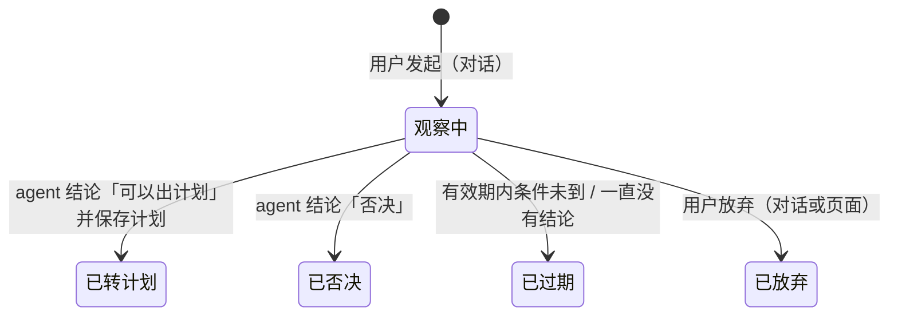

# v3.2.0 设计：检验与复盘、研究与跟踪、页面的时间控件与金额

> 状态：待用户批准。写成后只增不改。
> 与 [v3.1 设计](2026-11-06-v3.1-plan-line-account-and-web-design.md)（下称「v3.1 设计」）的关系：本文在 v3.1 的计划线、止损纪律、账户、简报与页面之上加三样东西——**检验与复盘**（roadmap 第 6 步，v3.2 主线）、**用户主动发起的研究与跟踪**、**页面的时间控件与金额显示**。v3.1 设计没被本文改动的部分仍然有效；改动之处逐条列在 §15，冲突时以本文为准。
> 文中「用户决定」是用户在 2026-11-08 的讨论里明确说的；「我的判断」是设计者替用户做的默认选择，用户可以推翻；两者不混写。
> 实施方式：本文批准后按仓库约定写实施 plan（`docs/plans/`），由子代理分层实施（实现 `sonnet`、审查 `opus`）。

---

## 1. 为什么做这一版

**用户原话（2026-11-08）**

- 对 v3.2 的主线：「可以，先将『检验与复盘』加入版本 list」；问到检验与复盘重要不重要、要不要一起做：「如果重要我建议一起做了」。
- 「优化：时间控件、金额（大部分场景保留两位即可，并且单位是美金）」。
- 「主动发起某一标的的研究，例如：最近 SNDK 下跌很多，我认为是入场的时间」。
- 问到研究的产出是一段对话分析就够、还是要留记录并每天跟踪：「留记录并跟踪」。
- 问到研究转成的计划要不要占待入场的 3 个名额：「不占用」。
- 问到复盘先看「规则行不行」还是「我执行得怎么样」：「你建议呢」——设计者建议执行复盘排前、规则检验带样本门槛排后，用户：「可以」。

**2026-11-08 对现有代码的核实**

| 现象 | 依据 |
|---|---|
| 系统回答不了「规则行不行」「我执行得怎么样」 | 已结束计划只在 `v3_plans.outcome` 存一份平仓结果（`close_outcome`），页面只在账户视图列最近 5 份；没有按规则 / 形态 / 行业的汇总，没有把「计划说的」与「实际做的」逐份对照 |
| 简报页脚每天写「规则未经验证」 | `facts/brief.py::_footer_text` 固定文案；没有任何机制能让这句话有一天改掉 |
| 没买的计划没人回头看 | 过期、作废、被替换、被取消的计划只有结束原因，没有「如果照做会怎样」 |
| 对话里可以点名任何股票 | `toolsurface/validation.py::in_scope` 在 chat 模式恒真；`ensure_data` 能补五族数据；`save_plan` 能出计划 |
| 但「研究」没有产物 | 结论只能落成一份计划或一个 confirm / veto（`v3_verdicts` 按交易日一行）；「还没到位但值得盯」没有地方放 |
| 研究的股票第二天没有新数据 | `facts/collect.py::target_facts` 的采集目标是关注列表 + 持仓 + 有效计划；`ensure_data` 是一次性的 |
| 价位模板是突破型的 | `rule_levels`：最新收盘 ±0.5 ATR 入场、下方 2 ATR 止损；`check_agent_levels` 只允许 agent 把入场下沿压到最新收盘下方 2 ATR（`entry_too_low`） |
| 记成交的时间要手填带时区的 ISO 字符串 | `web/src/lib/home/TradeForm.svelte` 的「时间」是纯文本框，提示「如 2026-11-06T10:30:00-05:00」；出入金与对账的日期也是手填 `YYYY-MM-DD` |
| 页面上没有货币单位、小数位数不一 | `MetricValue` 显示服务端字符串原样；`price_value` 去尾零后整数不带小数（`100.000000 → 100`）、超过两位的小数原样保留不四舍五入（`123.4567`），有小数时至少两位（`40.5 → 40.50`） |

结论：v3.1 把「一份计划从出现到结束」记全了，v3.2 开始用这些记录——先看自己照不照做，再攒样本看规则；同时把用户自己的交易想法接进来，让它也走同一套记录与纪律。

---

## 2. 目标、非目标、反目标

**目标**

1. **执行复盘**（用户决定排前）。每份已结束的计划一行：计划说什么、实际做了什么、结果 R 倍数、偏差标签；一周一份汇总。
2. **规则检验**（用户决定排后，带样本门槛）。按触发规则、形态档位、行业组分组的胜率与平均 R；样本不足的组写「样本不足」而不是给数。
3. **如果照做会怎样**（我的提议，用户同意纳入）。没买的计划用后续日线算一遍假设结果，单独成组，不与真实成交混。
4. **研究是一条独立的记录**（用户决定）。用户点名一只股票写下论点，agent 当场研究并给结论；结论是「可以出计划」「值得盯」「否决」三选一；「值得盯」要落一个宿主能检查的条件。
5. **研究每天由宿主跟踪，不调模型**（我的判断，用户接受「跟踪」）。条件到了才在简报会话里让 agent 复看；一直不到就过期。
6. **研究转成的计划不占 3 个待入场名额**（用户决定）。其余纪律（一只股票一份有效计划、止损、账户、股数）全部照旧。
7. **页面的时间控件与金额**（用户决定）。时间与日期用控件选，不手填 ISO；金额与价格两位小数、带美元符号。

**非目标**

- 规则参数自动调优、按复盘结果自动改筛选规则：复盘只给数，改规则是另一版的事。
- 回测历史、把筛选规则跑到 2026-11 之前：只算库里已有的计划线。
- 盘中条件、价格告警推送：只有日线，条件在收盘后检查。
- 研究用的新数据源（卖方报告、社交媒体）：仍是现有五族。
- 概念学习（roadmap 第 4 步）、K 线图、扩大筛选范围、独立反方 agent。
- 多账户、币种换算：仍只有美元。

**反目标**（即使功能都在，出现这些也算失败）

- 规则检验在样本不足时给出胜率或平均 R 的数字。
- 假设结果与真实成交在任何一张表或一个数里混在一起。
- 复盘的任何一行与 `v3_plan_events` / `v3_trades` 对不上（复盘必须从记录现算，不另存一份会过期的副本）。
- 研究的股票当天缺日线、条件没法检查，系统却没有说。
- 研究转成的计划绕过了止损纪律、账户或股数计算中的任何一项。
- 一只股票同时存在两份有效计划，或两份观察中的研究。
- agent 在没有用户确认的情况下改掉研究的条件。
- 模型不可用时，研究的每日条件检查、复盘、周报也跟着没有：这三样全部由宿主算。
- 页面上出现没有货币单位、或小数位数不一的金额。
- 简报写成投资建议的口吻（沿用）。

---

## 3. 约束

v3.1 设计 §3 的约束全部沿用（只有日线、每天收盘后跑一次、Pi 的实测做法、工具面运维要求、只追加表、路由顺序）。另外：

- **v3.1 仍在观察期**。「连续 3 个定时交易日无人干预」（v3.1 设计 §15 第 6 步）还没走完。本版不改每日任务第 2 步（事实计算、筛选范围）的行为；第 1 步只把观察中研究的股票并进采集目标（与有效计划的股票同一处，`target_facts`），**不写关注列表**——关注列表是第 2 步的筛选范围，写它就改了名单（审阅记录 R1）；第 3 步加研究复查、第 5 步后加周报；`daily run` 的退出码语义不变。
- **真实库里的数据从 2026-11-07 起**。第一批可复盘的记录是这几天过期或作废的待入场计划；真实成交为零。复盘的全部计算必须能在空数据上跑出「没有记录」而不是报错。
- **复盘不另建记录类表**（我的判断，见 §4）。它从 `v3_plans`、`v3_plan_events`、`v3_trades`、`v3_candidates`、`price_bars` 现算。
- **迁移编号 035**，排在 034 之后；可重跑。
- **不改旧口径**：`screen-1`、`rule_levels`（0.5 / 2 / 4 倍 ATR）、`size`、`WorkbenchConfig`、`pending_cap = 3` 不动。
- **不写提供方名字**（`tests/test_no_zhipu_residue.py`）。本文不出现任何提供方或模型名。

---

## 4. 做法比较

**复盘怎么算：现算还是每天存一份**

| 做法 | 结论 |
|---|---|
| 每日任务算好存进一张表，页面读表 | 未选。作废一笔成交、补录一份计划都会让存好的行过期，要么重算要么出现对不上的数（反目标） |
| **页面打开时从记录现算；周报由每日任务用同一个函数算出来写进简报行** | **选定**（我的判断）。记录量是几十到几百份计划，现算在毫秒级；只有一份口径 |

**研究是什么：计划线的一个状态，还是独立的记录**

| 做法 | 结论 |
|---|---|
| 给计划线加一个「观察中」状态，研究就是没定价位的计划 | 未选。计划线的约束（价位全空或全有、名额、过期规则）与研究的生命周期（条件、复看、转计划）处处要加例外 |
| **独立的表 `v3_research` 与它的变化记录，转计划时在计划上记 `research_id`** | **选定**（我的判断，用户选定「留记录并跟踪」）。计划线一行不改语义，研究自己管自己的状态 |

**每天怎么跟踪：agent 每天重看，还是宿主盯条件**

| 做法 | 结论 |
|---|---|
| 简报会话每天把每只研究股票重看一遍 | 未选。每天多一次模型调用、多几分钟，而大多数日子条件没到，结论就是「继续等」 |
| **agent 从论点里提出一个宿主能检查的条件，用户确认；宿主每天算条件到没到，到了才让 agent 复看** | **选定**（我的判断）。前四步不多花模型调用；条件写在记录里，复盘时也能看当初等的是什么 |

**研究转成的计划占不占名额**

| 做法 | 结论 |
|---|---|
| 占。与规则名单的计划一视同仁 | 未选 |
| **不占。名额只约束规则信号的数量；用户自己发起、agent 确认的计划是深思过的** | **用户决定**。总仓位上限仍由股数算法把关 |

**研究从哪里发起**

| 做法 | 结论 |
|---|---|
| 只在对话里发起 | 页面上看不到有「研究」这件事 |
| 页面表单发起，再由系统起一个会话研究 | 未选。页面表单提交后要等一个模型会话，页面没有这种长任务的交互 |
| **对话里发起并得出结论；页面有「研究」卡片组看记录、可以放弃，「发起研究」按钮打开助手面板并预填一句话** | **选定**（我的判断） |

---

## 5. 检验与复盘

### 5.1 复盘的对象

每份进入终态的计划（`closed`、`expired`、`invalidated`、`replaced`、`cancelled`）一行。有效计划（`pending`、`open`）不进复盘，它们在「计划与持仓」里。补录（`kind = adopted`）的计划进复盘但只算结果、不打偏差标签，R 倍数写「补录，不计」（沿用 v3.1 §8.4）。

每行的内容：

| 列 | 来源 |
|---|---|
| 股票、状态、起止交易日、来源（规则名单 / 研究） | `v3_plans` |
| 计划说的：入场区间、初始止损、目标、有效期、股数、最长持有 | `v3_plans` 行的最终值（修订会改行，`revised` 事件的 before / after 只记改过的键；`created` 事件不带价位）。止损用 `initial_stop`；待入场阶段修订止损时宿主同步改 `initial_stop`（审阅记录 R3）。有效期窗口是从保存日的下一个交易日到最终 `valid_until`（延续会覆盖 `valid_from`，审阅记录 R2） |
| 实际做的：首笔买入价与日期、卖出价与日期、成交股数 | `v3_trades`（未作废） |
| 结果：已实现盈亏、R 倍数、离场原因 | `v3_plans.outcome`（已平仓）；没买的计划没有真实结果 |
| 偏差标签 | §5.2，宿主按记录算 |
| 假设结果 | §5.3，只对没买的计划 |
| 分组键：触发规则、形态档位、行业组 | `v3_candidates` 里该计划保存当天（`plan.session`）该股票的那一行；研究转成的计划没有这一行，分组键记「用户研究」 |

### 5.2 偏差标签

一份计划可以有零个或多个标签；没有标签且（买了，或因价格从未进入场区间而没买）记为「照做」。标签全部由宿主按记录算，不用模型：

| 代码 | 文案 | 判定 |
|---|---|---|
| `not_bought_in_zone` | 未买入：价格进过入场区间 | 待入场终态且无成交；有效期窗口（§5.1，保存日的下一个交易日到最终 `valid_until`）内有任一交易日的日线满足 `low ≤ entry_high` 且 `high ≥ entry_low` |
| `not_filled` | 未买入：价格未进入场区间 | 待入场终态且无成交，且上一条不成立。**不算偏差**，算「照做」 |
| `entry_out_of_zone` | 买价出区间 | `outcome.entry_in_zone` 为假（沿用 v3.1 §8.4），或买入时的 `deviation` 事件 |
| `over_bought` | 多买 | 买入时的 `deviation` 事件写了「多于计划的股数」 |
| `stop_order_missing` | 止损未挂 | 从买入到结束没有任何 `stop_order_confirmed` 事件 |
| `late_sell_after_stop` | 止损触及后晚卖 N 个交易日 | `outcome.stop_delay_sessions ≥ 1`，N 取它 |
| `late_sell_after_instruction` | 卖出指令后晚卖 N 个交易日 | 有 `sell_instruction` 事件（交易日 X），平仓交易日 Y 晚于 X 的下一个交易日；N = X 的下一个交易日之后到 Y 的交易日数 |
| `early_sell` | 早卖 | 离场原因 `manual`，且没有止损触及、没有卖出指令 |

规则：被替换、被取消、agent 否决作废的计划不打 `not_bought_in_zone`——结束不是用户的决定（替换与作废是宿主 / agent 的），只在假设结果里看它们。

### 5.3 如果照做会怎样（假设结果）

对没买的计划（五个终态里除 `closed` 之外、`kind = planned`）用计划行的价位（§5.1）和之后的日线模拟一遍，回答「照计划买了会怎样」。模拟规则（纯函数，我的判断，全部未经验证）：

1. **成交**：在有效期窗口（§5.1）内逐个交易日看：当天 `low ≤ entry_high` 则成交，成交价 = `min(open, entry_high)`；否则若当天收盘低于止损 → 「未成交：收盘跌破止损」（计划自己的作废规则，沿用 v3.1 §6.3 第 1 条）；窗口走完没成交 → 「未成交：价格未进入场区间」。**不**理会替换、取消、agent 否决：假设的意思就是「这份计划如果没被动过」。财报进入有效期的作废规则也不理会（我的判断：它改变的是有没有机会，不是规则对不对）。四种入场类型用同一条成交规则（审阅记录 R4：现有代码里入场类型没有任何行为，本版不给它加）。
2. **持有**：从成交日起逐日调用计划线现有的持仓检查（`execution/plan_line.holding_check`，它只产出 `stop_hit` / `target_hit` / `stop_raised` / `sell_instruction` 事件、不平仓；模拟器自己据事件离场），初始止损取 `initial_stop`、成本取成交价、`trail_atr` 取配置。`stop_hit` 当天离场，离场价 = `min(open, 当日生效的止损)`（跳空按开盘，沿用 v3.1 §7.3 第 5 条）；`sell_instruction` 则下一个交易日按开盘价离场。
3. **没走完**：日线用完还没离场 → 状态「进行中」，按最后一根收盘算浮动的 R。
4. **R 倍数** = (离场价 − 成交价) / (成交价 − `initial_stop`)，两位小数。

假设结果在复盘行里单独一列，在规则检验里单独一张表；任何汇总都不把它与真实成交相加。

### 5.4 周报

每周最后一个交易日的那次每日任务（判定：当天的下一个交易日落在另一个 ISO 周）在最终简报之后多做一件事：算本周汇总，写进当天的简报行（新列 `weekly_md`），单独推一条 Discord（新列 `pushed_weekly_at`，与简报推送一样每周只推一次，重跑不重推）。没有选定模型的日子一样产出并推送（周报全是宿主算的）；事实任务失败（错误简报）的日子不产出、下次运行不补（审阅记录 R5）——页面的复盘块是现算的，那一周的汇总照常能看。周报内容：

- 本周结束的计划几份；其中照做几份、有偏差几份；偏差标签各出现几次。
- 本周已平仓计划的 R 合计与各份一行（股票、R、离场原因、标签）。
- 本周没买的计划各一行（股票、结束原因、假设结果）。
- 账户：周初与周末总资产、本周已实现盈亏（账本算）。
- 本周名单：新上榜、掉出、再次上榜最多的股票（来自 `v3_candidates`）。
- 页脚沿用简报（数据截止、规则未经验证、金额单位美元）。

周报没有 agent 的部分，模型不可用照常产出。周报页面上在复盘块顶部显示最近一周，可切换以前的周。

### 5.5 规则检验

按三个键各分一次组：触发规则（一份计划的 `trigger_rules` 有几条就算进几组）、形态档位（`setup_tier`）、行业组（`industry`）。每组给：样本数、胜率（R > 0 的份数占比）、平均 R、R 合计。真实成交（已平仓的 `planned` 计划）一张表，假设结果（§5.3 里有成交且已离场的）另一张表。

样本门槛（配置 `v3.retro_min_sample`，缺省 10，我的判断）：样本数小于门槛的组只显示样本数与「样本不足」，不显示胜率与平均 R。表的开头写明统计口径：「规则未经验证；样本不足的组不给数」。

---

## 6. 研究与跟踪

### 6.1 状态

- 状态代码：`watching`（观察中）/ `planned`（已转计划）/ `rejected`（已否决）/ `expired`（已过期）/ `dropped`（已放弃）。后四个是终态。
- **一只股票同时最多一份观察中的研究**，由数据库部分唯一索引保证。同一只股票结束后可以再发起，是另一条记录。
- 研究与计划的关系：一只股票已有有效计划时不能发起研究（先看计划）；研究转成计划时在计划上记 `research_id`，研究记 `plan_id`。

### 6.2 发起（对话）

用户在对话里点名一只股票并说出论点（例：「最近 SNDK 下跌很多，我认为是入场的时间」）。agent 调 `start_research`（用户写入：先复述「将为 SNDK 建立研究，论点：……」，`confirmed` 为真才写，按 `request_id` 幂等）。写入时宿主：

1. 建研究记录：股票、论点原文、发起交易日 `created_session`、有效期末日 `valid_until`（从发起日起 `v3.research_sessions` 个交易日，缺省 20，我的判断）、来源 `chat`。
2. 记一行变化记录 `created`。

之后每天采集时，观察中研究的股票与有效计划的股票一样并进采集目标（`target_facts`），**不写关注列表**（审阅记录 R1）：关注列表是筛选范围，研究不该改名单。

然后 agent 按对话手册（§9）做研究：`ensure_data` 补数据，读日线、指标、资讯、申报、财报日、基本面，`compute_plan_levels` 看宿主价位；给出 §6.3 的结论。

### 6.3 结论与条件（agent）

`conclude_research` 三选一，必须给理由与反证、引用看过的工具调用：

| 结论 | 代码 | 之后发生什么 |
|---|---|---|
| 可以出计划 | `ready` | agent 照常 `save_verdict`（confirm）再 `save_plan`（§6.6）；保存成功时宿主把研究记为 `planned`、关联 `plan_id` |
| 值得盯 | `watch` | 必须带一个条件（下表）；在对话里条件由 agent 提出、**用户确认**（工具先复述条件、`confirmed` 为真才写）；有效期从当天重新起算 |
| 否决 | `reject` | 研究记为 `rejected`，原因写进记录 |

条件是宿主能用日线检查的四种之一（我的判断；取值由 agent 从论点里提、用户确认）：

| 代码 | 参数 | 文案 | 到了的判定（按当天日线） |
|---|---|---|---|
| `close_above` | `level` | 收盘站上 {level} | `close ≥ level` |
| `close_below` | `level` | 收盘跌破 {level} | `close ≤ level` |
| `touch_below` | `level` | 最低价触及 {level} 或以下 | `low ≤ level` |
| `close_above_ma` | `ma`（20 / 50 / 200） | 收盘站上 {ma} 日均线 | `close ≥ MA(ma)`，日线不足 `ma` 根时写「日线不足，未检查」 |

对话里结论存 `watch` 而没有条件、或 `ready` 后没有保存计划，研究仍是「观察中、无条件」：宿主每天不检查它，简报在「今天下不了结论的」里写「研究 {股票} 尚无条件」，到有效期自然过期。

### 6.4 每天的复查（宿主，每日任务第 3 步）

对每份 `watching` 且有条件的研究，从它复查到的交易日（`checked_through`）的下一个交易日逐日复查到当天 S（与计划线的补查同一做法，v3.1 §5）：

1. 当天该股票缺日线 → 不判、不推进；S 当天缺日线时简报与卡片写「缺日线，未复查」。
2. 条件到了 → 记 `triggered`（`triggered_session` = 那一天），研究进入当天待办（§6.5）；同一研究的同一次触发只记一次。
3. 日期到或过了 `valid_until` 且没有触发待复看 → `expired`，原因「{n} 个交易日条件未到」。
4. 否则推进 `checked_through`。

重跑幂等：宿主产生的研究变化记录按（研究、交易日、类型）唯一。

### 6.5 复看（agent，简报会话）

当天待办（`get_agenda`）新增一类「研究复看」：条件已到（`triggered_session` 非空）且当天还没有结论的研究。agent 重看一遍，再调 `conclude_research`：

- `ready` → 出计划（§6.6）；
- `watch` → 简报模式下**不能改条件**（没有用户在场确认），只能保留原条件、有效期从当天重算，`triggered_session` 清空；要换条件得在对话里做；
- `reject` → 否决。

简报模式的范围（`in_scope`）从「名单前 N 只」扩成「名单前 N 只 ∪ 当天待办里的研究股票」，否则 agent 无法为研究股票保存 verdict 与计划。

### 6.6 研究转成的计划

与规则名单的计划走同一个 `save_plan`，区别只有三处：

1. **不占名额**（用户决定）。名额统计只数 `research_id` 为空的待入场计划；替换规则的受害者也只从它们里选。研究计划自己仍受「一只股票一份有效计划」约束。
2. **入场类型多一种 `pullback`（回调买入）**。四种之一；研究计划可以用，规则名单的计划也可以用（agent 选类型）。
3. **价位护栏放宽一条**（我的判断，未经验证）。agent 自报价位时 `entry_too_low` 的下限从「最新收盘 − 2 ATR」放到「最新收盘 − `v3.research_entry_atr` × ATR」（缺省 4）；其余三条（入场上沿、止损距离 0.5–3 ATR、回报 ≥ 1R）不变。缺省价位仍取宿主规则价位。之后修订这份计划的价位（`revise_plan`）用同一个放宽的下限（审阅记录 R7）。

研究股票同时出现在名单前 N 只时：名单行标「研究中」，它不进当天的二次确认清单、不计入待办完成判定（审阅记录 R6）；它的结论走研究那条线。

保存成功后研究记 `planned`，计划记 `research_id`；之后这份计划的一切（复查、止损、买入、平仓、复盘）与别的计划一样。

### 6.7 变化记录

研究的每一次变化记一行（只追加）：研究、交易日、类型、一句原因、变化前后的值、来源（宿主 / agent / 用户）、引用。类型：`created`、`concluded`（含结论与条件）、`triggered`、`planned`、`rejected`、`expired`、`dropped`。页面卡片的时间线与简报「和昨天比变了什么」从这里读。

---

## 7. 页面微调：时间控件与金额

**时间与日期**（用户决定要控件；时区与默认值是我的判断）

- 记成交：「时间」拆成「日期」与「时间」两个原生控件（`type="date"`、`type="time"`），时区固定**美东**（成交发生在美股交易所），提示文字写明；默认值是此刻的美东日期与时间。提交时由页面拼成带美东时区偏移的 ISO 字符串（夏令时按日期算），后端接口与校验不变。
- 记出入金「生效日期」、对账「截至日期」：改成 `type="date"` 控件，提交口径不变（本机当天 0 点 / `YYYY-MM-DD`）。
- 显示时间沿用 `fmtBeijing`（北京时间）。

**金额与价格**（用户决定两位小数、单位美元）

- 页面上所有金额与价格：两位小数、前缀 `$`（负数写 `-$12.34`）；股数整数、百分比沿用。覆盖：抬头总资产、账户条四项、计划卡片的价位（入场、止损、目标）、持仓的均价与最新收盘、浮动盈亏、平仓结果、复盘与研究卡片的价格。
- 后端 `price_value` / `price_text` 改为取到分（`98.000000 → 98.00`、`40.5 → 40.50`、`123.4567 → 123.46`），与 `money_value` 同口径；简报、Discord、工具返回里的价格随之两位小数，不加货币符号，页脚加一句「金额单位美元」。
- 库里的精度不变（`NUMERIC(18,6)`），只改显示。

---

## 8. 简报与 Discord 的变化

简报（v3.1 §11 的十段）新增一段、改两段：

- 第 2 段「和昨天比变了什么」：加研究的变化（新研究、条件已到、转计划、否决、过期、放弃），各一句。
- **新增第 5a 段「研究」**（排在「待入场计划」之后）：每份观察中的研究一行——第几天、论点（截到 40 字）、条件、最新收盘、状态（「条件已到，待复看」/「观察中」/「缺日线，未复查」/「尚无条件」）；最终简报里加 agent 当天的结论一句。没有研究时整段不出现。
- 第 8 段「今天下不了结论的」：加「研究 {股票} 尚无条件」「研究复看 {股票}」（待办未完成）。
- 页脚：加「金额单位美元」。

Discord 摘要：研究条件到了的，在「新计划」之后加一行「研究 {股票}：条件已到（{条件}）」。周报单独一条（§5.4）。

---

## 9. 工具面的变化

现有 31 个工具保留。新增四个（名称留给实施者，职责如下）；写工具沿用约定：出错返回错误信封；用户写入先复述、`confirmed` 为真才写、按 `request_id` 幂等；agent 写入要引用看过的工具调用。

| 工具 | 模式 | 职责 |
|---|---|---|
| 发起研究 | chat | 用户写入：股票、论点 → 建研究、记 `created`；该股票已有有效计划或观察中的研究时拒绝并返回那份 |
| 研究结论 | brief、chat | agent 写入：研究编号、结论三选一、理由、反证、引用；`watch` 带条件时是用户写入（先复述条件，`confirmed` 为真才写）；brief 模式带新条件被拒绝（`condition_needs_user`） |
| 放弃研究 | chat（页面也调它） | 用户写入：研究编号、原因 → `dropped` |
| 读研究 | brief、chat | 缺省返回全部观察中的研究；可按状态、股票、编号过滤，每份带变化记录 |

现有工具的变化：

- `save_plan`：`entry_type` 接受 `pullback`；该股票有观察中且结论为 `ready` 的研究时，保存成功后把研究记 `planned` 并在计划上记 `research_id`；名额检查只数 `research_id` 为空的待入场计划，有 `ready` 研究的股票不做名额检查；价位护栏按 §6.6 第 3 条放宽。
- `get_agenda`：返回里加 `research`（待复看清单，每项 `research_id`、`ticker`、`done`）；`complete` 把它算进去；`free_slots` 只数规则计划；二次确认清单与替换候选都跳过有观察中研究的股票（R6）。
- `get_candidates`：名单行加 `has_research`（该股票有观察中的研究），简报名单里对应标「研究中」。
- `revise_plan`：价位护栏对带 `research_id` 的计划用放宽的入场下限（R7）；待入场计划修订止损时同步改 `initial_stop`（R3）。
- `compute_plan_levels`：返回里 `entry_types` 四种。
- 页面接口（§10）的写入口沿用「只转发给工具面同名宿主函数」的做法。

---

## 10. 页面

在 v3.1 的一个页面上加两块、改一块：

| 块 | 内容 |
|---|---|
| **研究**（新，右栏，「计划与持仓」之下） | 两组：观察中、已结束（缺省折叠）。每份一张卡片：股票、第几天、论点、条件与「最新收盘 vs 条件」、状态（`StatusPill`，新领域 `research`）、agent 最新结论一句、关联计划（已转计划时可点到计划卡）；可展开变化记录时间线；观察中的有「放弃研究」（两步确认）。组标题旁「发起研究」按钮：打开助手面板并把输入框预填为「研究 {股票}：」（股票留空时预填「研究 」），用户补上论点发送 |
| **复盘**（新，左栏，「今日简报」之下） | 顶部本周汇总（§5.4，可切换以前的周）；中间执行复盘表：每份已结束计划一行（股票、起止、计划说的 / 实际做的、R、偏差标签、假设结果），缺省最近 20 份、可翻；底部规则检验两张表（真实成交 / 假设结果），组不足样本的只显示样本数与「样本不足」。没有记录时整块显示「还没有已结束的计划」 |
| **记成交 / 记出入金 / 对账**（改） | §7 的控件 |
| 金额与价格（改） | §7 的两位小数与 `$` |

- 宽屏两栏：左栏今日操作、简报、复盘；右栏账户条、计划与持仓、研究。窄屏单栏顺序：今日操作 → 账户条 → 计划与持仓 → 研究 → 简报 → 复盘。
- 沿用 `web/src/lib/ui` 的组件层与 [design-system.md](../design-system.md)；新组件进 §6.2.1 的表，新状态词进 `status.ts`（领域 `research` 五个状态、领域 `retro_tag` 的偏差标签）。
- 接口（名称留给实施者）：研究两组与单份（含变化记录）、放弃研究；复盘一个读接口返回记录、周报与规则检验，带 `week` 参数切换周报。

---

## 11. 数据（迁移 035，可重跑）

新增与改动留给实施者命名，职责如下：

- **`v3_research`**：研究记录（股票、论点、状态、发起交易日、有效期末日、条件 JSON 与文案、最新结论与理由与引用、`checked_through`、`triggered_session`、`plan_id`、结束交易日与原因、来源、agent 会话、时间戳）。部分唯一索引：`status = 'watching'` 时每只股票一份。状态 CHECK 五个值。
- **`v3_research_events`**：只追加的变化记录，形状同 `v3_plan_events`；宿主事件按（研究、交易日、类型）唯一。加进 `tests/test_no_update_on_append_only_tables.py` 的清单。
- **`v3_plans`**：加 `research_id BIGINT REFERENCES v3_research(id)`（可空）。`entry_type` 没有数据库 CHECK，四种由代码（`ENTRY_TYPES`）保证。
- **`v3_briefs`**：加 `weekly_md TEXT`、`pushed_weekly_at TIMESTAMPTZ`。
- 真实库执行前先 `pg_dump` 备份（沿用 [migrations-and-backup.md](../operations/migrations-and-backup.md) 的步骤），需用户授权（§13）。

---

## 12. 配置

`v3` 配置节新增的键（名称留给实施者；取值是我的判断，都标明未经验证）：

| 键 | 缺省 | 含义 |
|---|---|---|
| `research_sessions` | 20 | 研究有效期（交易日），发起或 `watch` 结论当天起算 |
| `research_entry_atr` | 4.0 | 研究计划 agent 自报价位的入场下限：最新收盘 − 该倍数 × ATR |
| `retro_min_sample` | 10 | 规则检验每组的样本门槛，不足写「样本不足」 |

`trail_atr`、`max_hold_default` 在假设结果里沿用现值。

---

## 13. 上线步骤（每一步都需要用户单独授权）

1. 真实库备份并执行迁移 035。
2. 重新加载页面服务（前端重建 `web/dist`）。
3. 每日任务不需要重装 LaunchAgent（命令不变）；下一个定时交易日观察第 3 步的研究复查与周五的周报。
4. 在对话里发起一份真实研究，走完「发起 → 结论 → 条件 → 次日复查」一轮。
5. v3.1 的「连续 3 个定时交易日无人干预」继续计数，不因本版重置（本版不改前两步）。
6. 第 3、4 步通过后更新 roadmap 与 CHANGELOG，发布 v3.2.0。

---

## 14. 留给实施者

- 表、列、工具、路由、组件、事件、配置键的命名。
- 复盘纯函数的模块位置（`execution/` 还是 `facts/`）：唯一要求是不读库、不 import 上层。
- 假设结果模拟里「下次开盘卖出」在最后一根日线上触发时的处理（没有下一根 → 进行中）。
- 周报的 Markdown 结构与 Discord 分条；「周」的页面切换方式。
- 研究条件 JSON 的字段名；均线取哪个现有指标函数。
- 页面美东时间的偏移计算方式（夏令时）；`$` 前缀在 `MetricValue` / `PlanLevels` 上的 prop 形状。
- 实施 plan 按仓库约定按层合并 Task（迁移与仓储、纯函数、编排与工具面、页面接口、前端、收尾），标出前端与后端可并行；测试分级沿用仓库约定。

---

## 15. 与 v3.1 设计的出入

| v3.1 设计 | 本文 |
|---|---|
| §4「待入场计划最多 3 份」对所有计划 | 只约束规则名单的计划；研究转成的计划不占名额（用户决定） |
| §6.4「对话里用户点名出计划……同样受名额约束」 | 经研究转成的计划不受名额约束；对话里不经研究直接点名出计划仍受约束 |
| `ENTRY_TYPES` 三种 | 四种，加 `pullback` |
| `check_agent_levels` 的 `entry_too_low` 固定 2 ATR | 研究计划放宽到 `research_entry_atr`（缺省 4）ATR |
| §9.3 待办四类 | 五类，加「研究复看」 |
| §9.3 简报模式范围「名单前 N 只」 | 加上当天待办里的研究股票 |
| §11 简报十段 | 十一段，加「研究」；第 2、8 段与页脚有增 |
| §12 页面四块 | 六块，加「研究」「复盘」 |
| §13 迁移 034 | 加迁移 035 |
| `price_value` 去尾零、至少两位 | 固定两位（取到分） |
| 记成交时间手填 ISO | 日期与时间控件，美东时区 |

---

## 16. 验收

**本版新增**

| # | 标准 |
|---|---|
| B1 | 一份已平仓计划的复盘行：计划说的、实际做的、R 倍数与 `outcome` 一致；偏差标签按 §5.2 逐条有测试（八个代码各至少一例，`not_filled` 记照做） |
| B2 | 被替换 / 被取消 / agent 否决的待入场计划不打 `not_bought_in_zone`；有效期内价格进过区间却没买的过期计划打它 |
| B3 | 假设结果：成交价、离场价、R 与手算一致；收盘跌破止损前未成交 → 未成交；日线用完 → 进行中；替换与取消不影响模拟 |
| B4 | 规则检验：样本数低于门槛的组没有胜率与平均 R 字段的数字，有「样本不足」；真实与假设两张表互不相加 |
| B5 | 复盘在空库上返回空记录与「还没有已结束的计划」，不报错 |
| B6 | 周报只在每周最后一个交易日的运行里产出并推送；同一周重跑不重推；模型不可用照常产出 |
| B7 | 发起研究：建记录、加关注列表、记 `created`；该股票已有有效计划或观察中研究时拒绝并返回那份；同一 `request_id` 重放返回原行 |
| B8 | 研究条件四种各有「到了 / 没到 / 日线不足」的测试；缺日线不推进 `checked_through`；到了记一次 `triggered`，重跑不重复；到期无触发 → `expired` |
| B9 | 待办里出现条件已到的研究；agent `ready` → 保存的计划带 `research_id`、研究记 `planned`；`watch` 在 brief 模式带新条件被拒绝；`reject` → `rejected` |
| B10 | 研究计划不占名额：3 份规则计划满员时研究计划照常保存；替换受害者只从规则计划里选；同一股票第二份有效计划仍被拒绝 |
| B11 | 研究计划 agent 自报入场下沿到最新收盘 − 3.5 ATR 通过、− 4.5 ATR 被拒；规则名单计划 − 2.5 ATR 仍被拒 |
| B12 | 简报：有研究时出现「研究」段与每份一行；条件已到写「条件已到，待复看」；缺日线写「缺日线，未复查」；没有研究时整段不出现；Discord 有研究条件行；页脚含「金额单位美元」 |
| B13 | 页面：研究卡片两组、放弃两步确认、「发起研究」预填助手输入框；复盘块三部分；记成交的日期与时间控件拼出带美东偏移的 ISO（夏令时与冬令时各一例）；金额与价格两位小数带 `$` |
| B14 | `price_value(Decimal("40.5")) == Decimal("40.50")`、`price_value(Decimal("98.000000")) == Decimal("98.00")`、`price_value(Decimal("123.4567")) == Decimal("123.46")` |
| B15 | 研究采集：观察中研究的股票进每日采集目标；关注列表与筛选范围不因研究而变 |
| B17 | 研究股票同时在名单前 N 只：不进二次确认清单，待办仍可完成；名单行标「研究中」 |
| B18 | 待入场计划修订止损后 `initial_stop` 同步；研究计划修订价位时入场下限按放宽值 |
| B19 | 没选定模型的周末交易日仍产出并推送周报；错误日不产出 |
| B16 | 一只股票同时两份观察中研究被数据库约束拒绝 |

**沿用**：v3.1 §18 的 A1–A22 与 v3 设计的验收条款继续成立；v3.1 的测试在本版改动后全部通过（`price_value` 两位小数引起的期望字符串按新口径更新，不改断言的意思）。

---

## 17. 审阅记录

2026-11-08 builder check（一名没有参与讨论的工程师读本文后提出的问题，`opus` 子代理）。七个问题都是实施层面的取舍，由设计者裁定如下，用户可以推翻；四处与现有代码不符的说法已在正文改正。

| # | 问题 | 裁定 |
|---|---|---|
| R1 | 研究股票写进关注列表会改第 2 步的筛选范围（`load_inputs` 用「范围文件 ∪ 关注列表」），与 §3 矛盾；`from_watchlist` 超过 100 只还会让整份关注列表失效 | **不写关注列表**。研究股票只并进采集目标（`target_facts`），与有效计划的股票同一处。§3、§6.2、§9、B15 已改 |
| R2 | `continue_plan` 每次延续覆盖 `valid_from` / `valid_until`，按列值逐日检查会漏掉最初到最后一次延续之间的交易日 | 有效期窗口 = 保存日（`plan.session`）的下一个交易日到最终 `valid_until`。§5.1、§5.2、§5.3 已改 |
| R3 | 「计划说的」用最终价位还是最初价位；`revise_plan` 改止损不更新 `initial_stop`，R 的分母会错 | 用计划行的最终值；待入场阶段修订止损时同步改 `initial_stop`（买入前的止损就是初始止损）。§5.1、§9 已改，验收 B18 |
| R4 | 四种入场类型在模拟里要不要各自的成交规则 | 不要。现有代码里 `entry_type` 没有任何行为，本版不加；模拟对所有类型用同一条规则，`pullback` 是给人看的标签。§5.3 已写明 |
| R5 | 没选模型、或事实任务失败的那天恰好是周末交易日，周报怎么办 | 没选模型照常产出并推送（全是宿主算的）；事实任务失败的日子不产出、不补——页面复盘块现算，不缺那一周。§5.4 已改，验收 B19 |
| R6 | 研究股票同时在名单前 N 只时，待办的确认清单与完成判定要不要排除它 | 排除：不进二次确认清单、不进替换候选、不计入完成判定；名单行标「研究中」。§6.6、§9 已改，验收 B17 |
| R7 | `revise_plan` 的护栏固定 2 ATR，研究计划修订价位会被拒 | 带 `research_id` 的计划在 `revise_plan` 里用同一个放宽的下限。§6.6、§9 已改 |

改正的说法：§5.1 的「`created` 事件链上的价位」（`created` 事件不带价位，只有 `revised` 的 before / after 有改过的键）；§1 对 `price_value` 现状的描述（有小数时已至少两位，不统一的是整数不带小数与超过两位不四舍五入）；§3 与 §6.2 关于关注列表的矛盾；§5.3 对 `holding_check` 的描述（它只产出事件、不平仓）。
